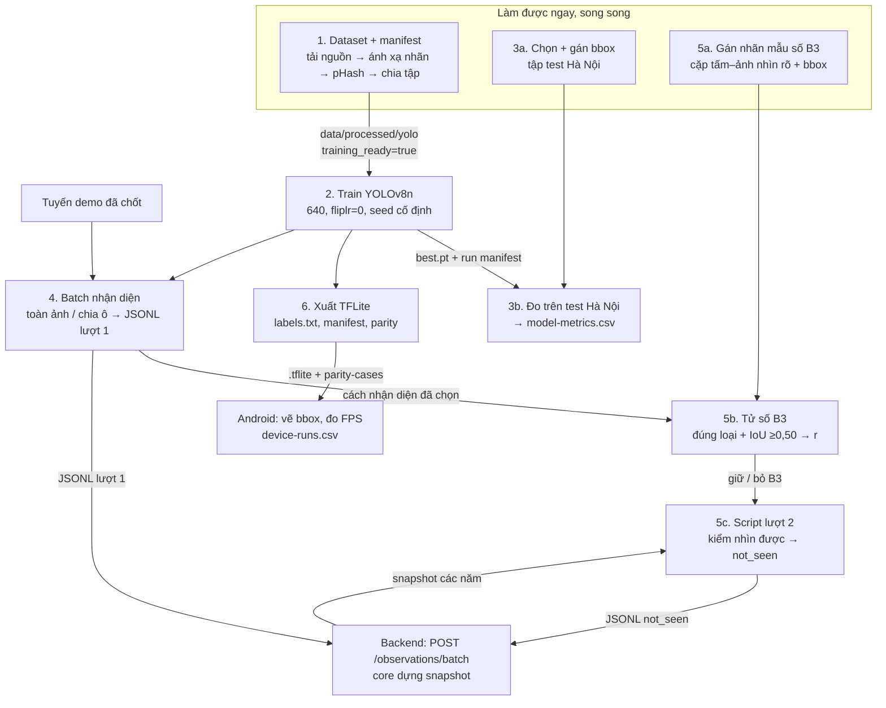
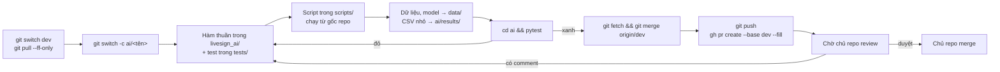

# Workflow phần AI

Các bước để làm xong dòng "AI" trong [Phạm vi MVP](../docs/requirements.md#phạm-vi-mvp).
Thiết kế gốc: [ai-pipeline.md](../docs/ai-pipeline.md). Định dạng đầu ra:
[observation.md](../docs/contracts/observation.md), [model.md](../docs/contracts/model.md).
Tham số: [params.yaml](../config/params.yaml). Đây là hướng dẫn làm, chưa phải kết quả đã chạy.

## Luồng dữ liệu và phụ thuộc



Điểm chặn: phần 1 chặn gần hết phần khác. Tuyến demo chặn phần 4. Lượt 2 cần
snapshot của backend; trước đó test bằng dữ liệu giả.

Phần AI **không** viết định vị, gộp, điểm tin cậy hay vòng đời. Các thuật toán đó chỉ
nằm trong module Java `core`. Batch AI chỉ gửi gợi ý (`feature_candidates`).

## Vòng làm việc cho mỗi phần



- Commit nhỏ, message tiếng Việt, mở đầu `ai:`.
- Test không cần torch hay GPU. Phần nặng tách logic thuần ra để test.
- PR đổi `classes.yaml`, `params.yaml` hoặc hợp đồng thì ghi mục "Đổi hợp đồng".
- Không commit ảnh, checkpoint, `.tflite`, token.

| Thứ tự | Nhánh gợi ý | Đầu ra chính |
| --- | --- | --- |
| 1 | `ai/manifest-dataset` | Dataset YOLO, manifest, mapping trong `classes.yaml` |
| 1 | `ai/test-ha-noi` | Danh sách ảnh test đã khóa, bbox gán tay |
| 1 | `ai/mau-so-b3` | CSV nhãn nhìn được cho mẫu số B3 |
| 2 | `ai/train-yolov8n` | Script train, run manifest |
| 3 | `ai/do-model` | `model-metrics.csv` |
| 3 | `ai/xuat-tflite` | Bộ giải mã, `labels.txt`, manifest, parity |
| 3 | `ai/batch-nhan-dien` | Chia ô, NMS, xuất JSONL, hàm kiểm dòng |
| 4 | `ai/bai-thu-b3` | `b3-test.csv` |
| 4 | `ai/luot-2-not-seen` | Script kiểm nhìn được và xuất not_seen |

## 1. Dataset và manifest

Mục tiêu: dataset YOLO 12 lớp có manifest, `training_ready: true` trong
[classes.yaml](configs/classes.yaml).

1. Tải `zalo2020`, `roboflow`, `vnts_kaggle` vào `data/raw/<nguồn>/`, giữ nguyên gốc.
   Ghi URL và version chính xác, giấy phép, quyền phân phối lại, ngày tải.
2. `scripts/inventory.py`: đếm object theo nhãn gốc, cắt khoảng 20 crop mỗi nhãn
   thành ảnh lưới để xem.
3. Xem crop rồi điền `sources.<nguồn>.mapping`. Zalo 7 nhóm không tách được
   P.123a/P.123b: gán lại từ ảnh hoặc bỏ. Nhãn ngoài 12 lớp thì bỏ.
4. Lọc trùng giữa **mọi** nguồn trước khi chia: sha256 cho trùng tuyệt đối; xoay EXIF
   rồi tính pHash 64 bit; cặp Hamming ≤`training.phash_max_hamming` (6 bit) là ứng
   viên, xem bằng mắt rồi gom nhóm (union-find) thành `duplicate_group_id`.
5. Chia theo nguồn hoặc sequence, một nhóm trùng chỉ ở một split. Đề xuất giữ một
   nguồn hoàn toàn ngoài train. Ghi ngoại lệ vào manifest.
6. Xuất YOLO vào `data/processed/yolo/{images,labels}/{train,val,test}`. Sinh lại
   `dataset.yaml` từ `classes.yaml`; test hiện có bắt hai file khớp.
7. Manifest đủ trường ở mục "Manifest dataset" của ai-pipeline.md, có count thật theo lớp/split.

Test: ánh xạ nhãn, đổi bbox sang YOLO, Hamming, gom nhóm, chia tập không tách nhóm.

## 2. Train YOLOv8n

```powershell
yolo detect train data=ai/configs/dataset.yaml model=yolov8n.pt imgsz=640 batch=8 epochs=100 fliplr=0.0 seed=0 deterministic=True project=data/runs name=r001
```

- `fliplr=0.0` bắt buộc. Ultralytics mặc định lật ngang 0,5, làm P.123a thành P.123b.
- Colab dùng `batch=16`, ghi GPU thực được cấp. Thiếu VRAM thì giảm batch và ghi lại.
- Chọn checkpoint bằng validation, không nhìn tập test.
- Run manifest: phiên bản ultralytics/torch, GPU, hash manifest dataset, hash
  `args.yaml`, sha256 `best.pt`, thời gian train thực.
- Chép model vào `data/models/livesign-yolov8n-qcvn12-r001.pt`.

## 3. Tập test Hà Nội và model-metrics.csv

1. Chọn ảnh Mapillary Hà Nội khác sequence, người chụp và nhóm gần trùng so với
   train/val/fine-tune (kiểm bằng pHash). **Khóa danh sách `image_id` trước khi chạy model.**
2. Gán bbox 12 lớp bằng tay (CVAT, Label Studio hoặc
   [label-tool PoC](../tools/poc/label-tool/server.mjs)), lưu `data/processed/hanoi-test/`.
3. Đo bằng `model.val(data=..., split="test")`: `metrics.box.ap50`, `metrics.box.maps`,
   `metrics.box.r` theo lớp. Báo riêng biển nhỏ (đề xuất diện tích <32² px, ghi rõ),
   pano, ngày/đêm.
4. Ghi `results/model-metrics.csv` đúng cột ở [evaluation.md](../docs/evaluation.md).

## 4. Nhận diện hàng loạt và JSONL lượt 1

1. Lấy ảnh tuyến demo qua Mapillary Graph API: `id, creator, sequence, captured_at,
   computed_geometry, computed_compass_angle, camera_type, camera_parameters, width,
   height, thumb_2048_url`. Ghi kích thước thật sau giải mã, không upscale.
2. So trên cùng tập phát triển (không phải test Hà Nội):
   - Toàn ảnh `imgsz=2048`; ghi cỡ input thật model đã chạy.
   - Chia ô 640 px, chồng 20%: hàm thuần `tile_offsets(W, H, 640, 0.2)`, ô cuối dồn sát
     mép. Ví dụ W=2048, H=1152 → 8 ô.
   - Chọn bằng recall theo cỡ bbox và thời gian p50/p95; ghi vào run manifest.
3. Bỏ letterbox, cộng offset ô, clip; NMS theo lớp trên toàn ảnh (conf 0,25, IoU 0,45).
4. Mỗi detection một dòng:
   - `observation_id` cố định khi chạy lại, ví dụ `mly:<image_id>:<model_version>:<thứ tự theo x1>`.
   - `off_deg = box_angle(cx, W, H, is_pano, focal)`; `focal` từ `camera_parameters[0]`,
     thiếu thì fallback 0,8; `is_pano` từ `camera_type`.
   - `camera_heading_deg` từ `computed_compass_angle`.
   - `sign_lon/lat`, `sign_facing_deg`, `distance_m` để `null`; `core` quyết vị trí.
   - Chỉ `in_fov` tính được; `facing_camera`, `sharp`, `unoccluded` để `null` khi chưa có ngưỡng.
   - `outcome`: `seen` khi đủ metadata, còn lại `unknown`. Lượt 1 không tạo `not_seen`.
5. `feature_candidates`: feature Mapillary trong 30 m, phía trước camera, nhãn thuộc
   `mapillary_label_candidates` của lớp; ghi `ray_distance_m`. `core` áp ngưỡng và chọn.
6. Ghi `source_metadata.inference` (hash manifest model, input size, tile origin,
   kích thước toàn ảnh, ngưỡng).
7. Một trip một file `data/observations/<trip_id>.jsonl`. Hàm kiểm dòng theo hợp đồng
   có test. Importer POST tối đa 500 dòng/request.

## 5. Bài thử B3 và lượt 2

1. Mẫu số: cặp tấm–ảnh thuộc 12 lớp, nguồn ≥2048 px, người gán `visible` kèm bbox.
   CSV theo mục "Nhãn khả năng nhìn được" của observation.md, thêm cột bbox. Có model
   phụ gán nhìn được thì người duyệt 60 `image_id` ngẫu nhiên và mọi ca không chắc.
2. Tử số: chạy detector theo cách đã chọn ở phần 4; khớp khi đúng loại và IoU ≥0,50.
3. r = tử số / mẫu số; báo theo lớp, pano, cỡ biển, creator/sequence, số ảnh riêng
   biệt. Mẫu số 0 thì `not_run`, r=`null`.
4. r ≥50% giữ, <30% bỏ, ở giữa chỉ là phân tích phụ trong CLI. Ghi `results/b3-test.csv`;
   đổi `negative_evidence_enabled` trong PR có lý do.
5. Script lượt 2 (bắt buộc có code kể cả khi bỏ B3): lấy biển snapshot năm chụp; với ảnh
   có biển trong 30 m, kiểm `in_fov` (85% nửa góc ngang), `facing_camera` (≤45° so với
   hướng biển → camera), `sharp`, `unoccluded`. Đủ bốn cờ `true` và không phát hiện biển
   cũ → `not_seen` kèm `snapshot_run_id`; còn lại `unknown`. Khi ngưỡng nét/che còn
   `null`, dữ liệu thật không sinh `not_seen`; môi trường mô phỏng mới dùng được.

## 6. Xuất TFLite cho Android

```powershell
yolo export model=data/models/livesign-yolov8n-qcvn12-r001.pt format=tflite imgsz=640 half=True
```

1. Đọc tensor details thật (shape, layout, dtype, quantization), ghi vào manifest.
2. Sinh `labels.txt` từ `classes.yaml`: 12 dòng, không BOM, đúng thứ tự; có test.
3. `model-manifest.json` theo model.md, ví dụ `livesign-yolov8n-qcvn12-r001-i640-fp16`.
4. Bộ giải mã numpy theo pseudo-code model.md. Test bằng ví dụ W=1280, H=720 →
   bbox `[512,296,768,424]`.
5. `parity-cases.jsonl`: ngang/dọc, pad lẻ, xoay EXIF, không biển, hai biển gần, pano.
6. Thêm bản 416 để so trên máy thật. Int8 tùy chọn, hiệu chuẩn bằng train/val, không dùng test.
7. `.tflite` để `data/models/` và Drive chung. `device-runs.csv` đo cùng phần Android.

## Ngoài dòng AI nhưng cần cho phần AI

Các việc sau thuộc dòng "Dữ liệu" và "Thực nghiệm" của MVP, phần AI cần dùng:

- Corpus tuyến demo ba năm 2023–2025 có manifest và hash (đầu vào phần 4).
- Bộ mốc tuyến demo theo [ground-truth.md](../docs/contracts/ground-truth.md).
- Script importer gửi JSONL lên `POST /observations/batch`.
- Đo `device-runs.csv` trên máy Android thật, ít nhất 3 lượt.
