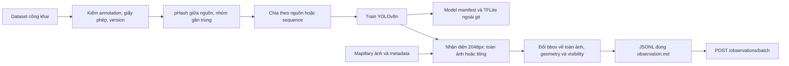

# Pipeline dữ liệu và nhận diện

Thiết kế để tạo model và lần thấy, **chưa train hoặc đo mới trong lần này**.
Danh mục [classes.yaml](../ai/configs/classes.yaml) đã có 12 mã; training_ready=false
và mapping nguồn rỗng. Chỉ Mapillary/dataset công khai có điều khoản phù hợp.



## Manifest dataset

Mỗi bản phát hành dataset có manifest cùng kho dữ liệu, version/hash bất biến.
Manifest ghi dataset-level và image-level; không chỉ số lượng tổng từ trang giới thiệu.

| Mức | Trường bắt buộc |
| --- | --- |
| Nguồn | source_id, source_url, dataset_version, retrieved_at, license_name/license_url, redistribution_status |
| Nhãn | original_label, sign_type_code/class_id, classes_version, mapping_status, ảnh đã kiểm |
| Ảnh | image_key, source_image_id, sha256, phash64, duplicate_group_id, source_sequence_id, split, annotation_ref |
| Bản dữ liệu | manifest_version, image_count thực, object_count theo lớp/split, split_rule, exclusions, config_sha256 |

Ví dụ **minh họa cấu trúc**, không khẳng định dataset đã tải/giấy phép đã kiểm:

```json
{
  "manifest_version":"illustration-dataset-r001",
  "source_id":"illustration:roboflow-source",
  "source_url":"https://universe.roboflow.com/",
  "dataset_version":null,
  "license_name":null,
  "license_url":null,
  "redistribution_status":"pending_check",
  "image_count":null,
  "classes_version":"qcvn12-2026-10-19",
  "label_mapping":[{"original_label":"<nhãn thực sau tải>","sign_type_code":"P.131a","mapping_status":"pending_image_check"}],
  "image_example":{"image_key":"illustration:img-01","source_sequence_id":"illustration:seq-01","duplicate_group_id":"illustration:dup-01","split":"validation","annotation_ref":"<ref sau kiểm tra>"}
}
```

URL trên là trang dịch vụ gốc, **không đủ định danh một bộ**; manifest dùng thật
phải có URL dự án/version chính xác, hash, giấy phép và count thực. Zalo 7 nhóm
không tự ánh xạ “cấm rẽ” thành P.123a/b; cần nhãn chi tiết hoặc gán lại từ ảnh.
Không dùng nhãn AI Mapillary làm train/ground truth; chỉ gợi ý tìm ảnh công khai để xem.

### Lọc trùng và chia tập

1. Hash bytes để tìm trùng tuyệt đối; giải mã ảnh đúng chiều rồi tính pHash 64 bit.
2. Tìm ứng viên gần trùng **giữa tất cả nguồn trước khi chia**, thử khoảng Hamming
   ≤training.phash_max_hamming (6, dự kiến). pHash gần không tự chứng minh cùng ảnh;
   kiểm bằng mắt/đối sánh, tránh xóa hai biển khác nhau có nền giống nhau.
3. Gom nhóm đã xác minh; hai annotation khác nhau trên cùng ảnh không tạo hai mẫu
   “độc lập”. Hợp nhất nhãn sau kiểm tra, giữ lineage mọi nguồn.
4. Chia theo nguồn/sequence và nhóm trùng, không chia ngẫu nhiên từng frame. Nếu
   duplicate_group nối hai nguồn dự định ở hai split, chuyển cả nhóm vào một split
   hoặc loại nhóm khỏi test; ghi ngoại lệ, không âm thầm phá quy tắc theo nguồn.
5. Tập test Hà Nội độc lập lấy ảnh công khai khác sequence/người/nhóm gần trùng;
   không chọn ảnh test nhìn dễ sau khi thấy kết quả. Dữ liệu fine-tune Hà Nội phải
   tách khỏi test. Không tune threshold/early stop/calibration int8 trên test.

**Cần nhóm quyết:** khóa nguồn/version và tỷ lệ split sau khi đếm theo lớp, đề xuất
giữ ít nhất một nguồn hoặc nhóm sequence hoàn toàn ngoài train; lý do là split
phần trăm đẹp chưa chứng minh độc lập. Chưa có count thực để cam kết tỷ lệ cụ thể.

## Train YOLOv8n và bàn giao

| Mục | Thiết kế dự kiến / cần đo |
| --- | --- |
| Model | YOLOv8n detect 12 lớp, checkpoint khởi đầu có nguồn/giấy phép rõ |
| Đầu vào train | training.imgsz=640; epochs=100 là giới hạn thử, không phải đã chạy |
| Máy cá nhân | Theo ai/README.md: RTX 3050 4 GB; batch_local=8 khởi đầu, giảm khi thiếu VRAM; thời gian cần đo |
| Colab | GPU được cấp thực tế ghi vào run manifest; batch_colab=16 là đề xuất, không bảo đảm luôn có T4 |
| Augment | Đề xuất scale/brightness nhẹ, crop/translation có giữ bbox; không flip ngang vì đổi trái/phải hoặc nội dung biển |
| Checkpoint | Chọn bằng validation mAP/recall theo lớp; lưu seed/config/exporter version/hash |
| Chỉ số | mAP50, mAP50-95, recall và số object test từng lớp; kèm nhóm bbox nhỏ, pano/ngày đêm |
| Xuất app | Theo contracts/model.md; input/precision còn chờ nhóm, kiểm parity sau export |

Các tùy chọn train/validation có trong
[tài liệu Ultralytics train](https://docs.ultralytics.com/modes/train/). Thiết kế này
không sao chép mặc định hiện hành thành cấu hình đã chốt: phải khóa config đầy đủ
trong run manifest. Chỉ đề xuất dạng augment; mức xác suất/cường độ phải được ghi
trước phép đo, không để thư viện tự đổi theo phiên bản rồi gọi là cùng thí nghiệm.

**Cần nhóm quyết:** đề xuất tắt flip ngang, không dùng augment làm thay nghĩa mã
biển; so augment nhẹ với không augment trên validation. Lý do: P.123a/P.123b và
các biển có chữ/số không giữ nhãn khi lật như đối tượng thông thường.

## Nhận diện hàng loạt ảnh Mapillary

Đọc image_id/creator_id/sequence_id/timestamp/GPS/heading/camera trước khi xử lý.
Lấy ảnh cạnh dài ≥batch_inference.image_long_edge_px=2048 khi nguồn cung cấp;
ghi kích thước thực, không upscale ảnh 1024 rồi nhận là dữ liệu 2048 có thêm chi tiết.

| Cách | Cấu hình đề xuất | Điều phải so trên cùng tập |
| --- | --- | --- |
| Nguyên ảnh | Letterbox toàn ảnh, thử inference 2048 trên batch Python; nếu bị hạ input 640 phải ghi rõ | Recall theo cỡ bbox, thời gian/VRAM; không gọi ảnh tải 2048 là inference 2048 nếu đã resize xuống |
| Tiling | Ô tile_size_px=640, overlap=0,20; pad mép; model chạy từng ô, chuyển hộp về toàn ảnh | Recall biển nhỏ, false positive ở mép ô, thời gian tổng, NMS toàn ảnh |

[summary.csv](../tools/poc/results/summary.csv) cho YOLO-World trên PoC: **8%** ở
confidence 0,10, **2%** ở 0,25 trên 357 dòng kiểm tra, không phải recall tập nhìn rõ.
[preparation-audit.md](preparation-audit.md) ghi 333 ảnh riêng biệt và lỗi manifest.
Biển vài chục pixel/ảnh khó là lý do **thử** tiling; chưa có bằng chứng tiling chắc
giải quyết được che khuất, đêm hoặc sai lớp. Không dùng tỷ lệ 2–8% để tuyên bố
YOLOv8n 12 lớp đã đạt hay chưa đạt ngưỡng B3.

```text
VỚI ảnh đủ metadata và quyền:
  KIỂM hash/size, phát hiện duplicate image_id
  CHẠY toàn ảnh hoặc từng tile theo run manifest
  ĐỔI bbox: bỏ letterbox, cộng tile offset, clip về toàn ảnh
  GỘP detection bằng NMS theo lớp trên toàn ảnh
  ĐỐI SÁNH target/tấm, tính off bằng geometry.py trên kích thước toàn ảnh
  KIỂM visibility độc lập; không đủ điều kiện thì unknown
  XUẤT một observation/tấm–ảnh, cùng tên cột hợp đồng, không gửi hai bản do tile trùng
```

Ví dụ độ lớn tính toán: W=2048,H=1152, ô=640,stride=512 →
nx=ceil((2048−640)/512)+1=4, ny=2 →8 ô. Cố định offset ô cuối sao cho phủ mép,
lưu danh sách offset; không ngầm coi mọi cặp ô chồng đúng 20% sau dồn ô mép.
Nếu **giả định** 50 ms/ô +30 ms decode/NMS thì 1.000 ảnh khoảng
1.000×(8×0,05+0,03)=430 s, chưa tải/mạng/ghi file. Đây chỉ là ví dụ ước lượng;
thay bằng p50/p95 đo trên ít nhất mẫu đại diện và số tile thật, báo VRAM/OOM.

**Cần nhóm quyết:** chọn toàn ảnh hay tiling bằng recall/thời gian trên cùng tập
phát triển; 640/20% là ứng viên trong params, không nâng thành mặc định đã chứng minh.
Panorama cần thiết kế crop/phép chiếu riêng để tránh méo; nếu dùng ô equirectangular
thì ghi rõ hạn chế, xử lý seam và đổi hộp về toàn pano trước geometry.

## Bài thử giữ/bỏ B3

| Thành phần | Định nghĩa |
| --- | --- |
| Mẫu số | Các cặp tấm–ảnh thuộc lớp mục tiêu, được kiểm tra độc lập là nhìn rõ, nguồn ≥2048px nếu có; không dùng mọi ảnh đi qua |
| Tử số | Các cặp trong mẫu số có detection đúng tấm/loại bằng quy tắc đối sánh đã khóa |
| Đối sánh detector | Đề xuất IoU ≥0,50 với bbox gán độc lập, không lấy ground_truth.match_radius_m để chấm bbox |
| Audit | Model đọc ảnh khác detector đang đo; duyệt 60 image_id ngẫu nhiên và mọi ca không chắc theo params |
| Quyết định | r≥0,50 giữ B3; r<0,30 bỏ; 0,30≤r<0,50 cần nhóm quyết, báo cả số đếm và lỗi |
| Không đủ mẫu | `not_run`, mẫu số=0 thì r=null; không ép về 0% hoặc dùng PoC thay thế |

**Cần nhóm quyết:** đối sánh detection dùng đúng loại + IoU≥0,50 và khóa quy tắc với
bbox nhìn rõ trước khi thử; lý do: chỉ đúng hướng có thể nhầm tấm khác chung cột.
Báo theo lớp, pano, cỡ biển và creator/sequence, kèm số ảnh riêng biệt/cặp; nhiều
frame cùng người không phải nhiều bằng chứng độc lập. Nếu B3 không đạt, vẫn có
B0–B2 và mô phỏng mâu thuẫn riêng, không sinh âm từ detector kém để làm demo.
