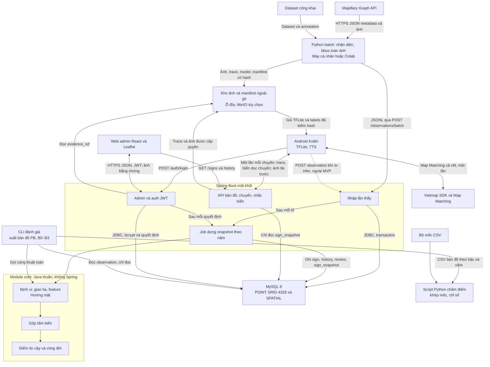
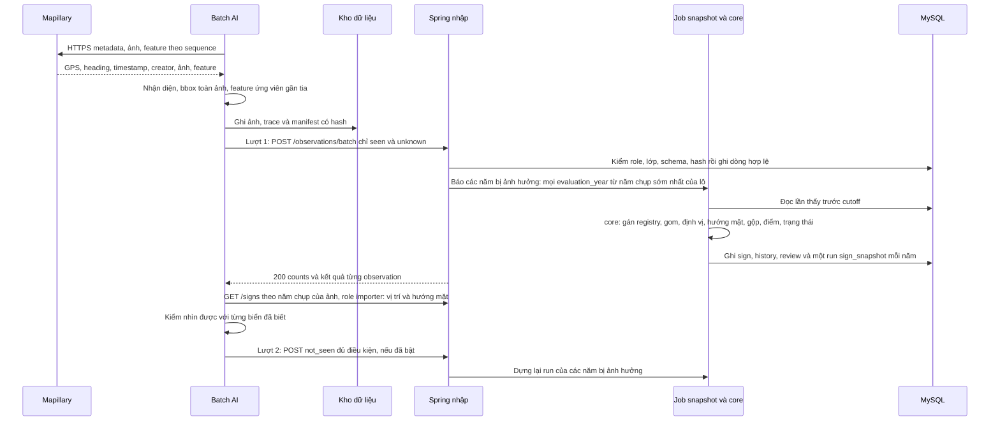
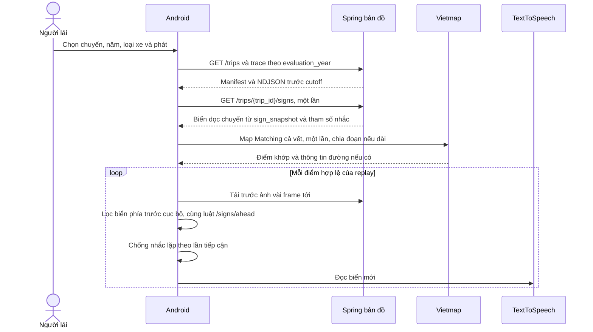
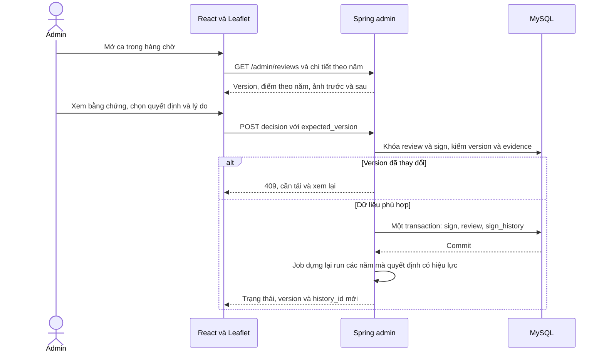
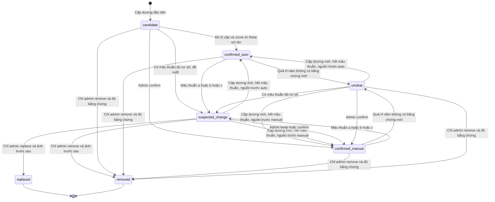
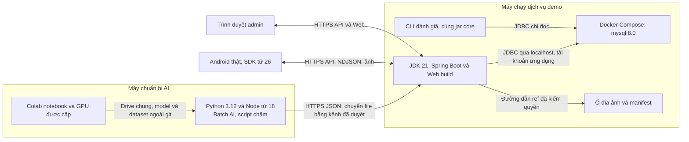

# Kiến trúc LiveSign

Thiết kế 1.2; chưa dựng project/dịch vụ. Phạm vi phải làm ở [Phạm vi MVP](requirements.md#phạm-vi-mvp). Nguồn API/CSDL/lớp/đơn vị ở
[contracts](contracts/api.md), thuật toán ở [algorithms.md](algorithms.md).
Một backend Spring Boot chia module; Python chạy batch/notebook, không là dịch vụ online.
Thuật toán lõi (định vị, hướng mặt, gộp, điểm tin cậy, vòng đời) viết **một lần** trong
module Java `core` không phụ thuộc Spring; dịch vụ và công cụ đánh giá cùng gọi module này.

## Bốn quyết định kiến trúc (1.2, chốt 19/10)

| Quyết định | Vì sao |
| --- | --- |
| **Một module `core` cho thuật toán + CLI đánh giá** dùng chung | Thang PB, B0–B3 phải chạy lại nhiều lần với tham số khác nhau. Viết thuật toán hai lần (Java cho dịch vụ, Python cho đánh giá) thì kết quả trong quyển có thể khác app. CLI xuất bản đồ ra CSV; script Python chỉ khớp bộ mốc và tính chỉ số |
| **Dựng sẵn snapshot theo năm** vào bảng `sign_snapshot` | Mọi API đều theo `evaluation_year`. Tính lại trong bộ nhớ ở mỗi request thì chậm và khó kiểm. Dựng sau mỗi lô nhập hoặc quyết định admin; API chỉ đọc |
| **Phát lại không gọi mạng theo từng điểm** | Tải biển dọc chuyến một lần (`GET /trips/{trip_id}/signs`), Map Matching cả vết một lần, app tự lọc biển phía trước cục bộ. Bớt độ trễ khi nhắc, bớt quota Vietmap, chạy được khi mạng chập chờn. `/signs/ahead` giữ làm bản tham chiếu để test đối chiếu |
| **Định vị nằm trong `core`, sau khi gom lần thấy** | Một ảnh không giao tia được. Batch AI chỉ gửi tư thế camera, bbox và feature Mapillary ứng viên; `core` gom các lần thấy cùng tấm rồi mới định vị, ước lượng hướng mặt và gộp |

## Thành phần và hợp đồng nối

Ingest kiểm quyền nội bộ trước xử lý; login của app/web/importer được phục vụ bởi
module Admin/auth qua cùng base path `/api/v1`, không phải dịch vụ thứ hai.
Ảnh trong kho không công khai trực tiếp cả thư mục; API kiểm trip/sign/cutoff/role.
Gói model copy cục bộ có manifest, chưa thiết kế endpoint phát hành model tự động.

| Module | Trách nhiệm | Không nhận thêm trách nhiệm |
| --- | --- | --- |
| Nhập | Validate envelope/dòng, idempotency hash, trip, lưu bền; gọi job snapshot | Không tự gộp, không tự coi upload là bằng chứng mới |
| Job snapshot | Với mỗi evaluation_year bị ảnh hưởng: gọi `core` trên **toàn bộ** observation trước cutoff, ghi sign/history/review hiện tại và một run `sign_snapshot` đủ mọi biển của năm | Không phục vụ request đọc; không dựng run chỉ chứa một phần biển |
| core: Định vị | Gom lần thấy cùng tấm → giao tia → feature Mapillary → camera_proxy; ước lượng hướng mặt | Không gọi CSDL hay HTTP; nhận dữ liệu, trả kết quả |
| core: Gộp | Liên kết observation→tấm, registry ổn định, nhiều tấm chung cột | Không quyết gỡ/thay |
| core: Tin cậy | Cặp người/năm, score/độ mới/mâu thuẫn, trạng thái | Không dùng confidence detector làm score |
| API bản đồ | Bbox, biển dọc chuyến, ahead, trip/ảnh/trace, sign/history — đọc `sign_snapshot` | Không tính lại điểm khi đọc |
| Admin/auth | bcrypt, JWT/role, quyết định có version, bằng chứng; gọi job snapshot | Không xóa observation/history để bác mâu thuẫn |
| CLI đánh giá | Chạy `core` trên observation trước cutoff với từng bậc/tham số, xuất CSV bản đồ | Không ghi vào CSDL dịch vụ |
| Script chấm (Python) | Khớp một–một với bộ mốc, precision/coverage/bootstrap, bảng cho quyển | Không định vị, gộp hay tính điểm lại |

### Ranh giới dữ liệu và quy mô MVP

| Nguồn | Nơi giữ / ai được đổi |
| --- | --- |
| Lần thấy, payload hash và ảnh nguồn | Observation + kho manifest bất biến; importer thêm dữ liệu, không sửa ảnh/creator/time gốc |
| Liên kết lần thấy–tấm | Registry có version, do `core` đề xuất; adapter lưu bền. Mỗi năm dùng liên kết từ dữ liệu trước cutoff, không dùng target hiện tại làm nhãn đúng cho quá khứ |
| Quyết định | Review/history append-only, admin ghi với version; `core` chỉ áp dụng quyết định đủ cutoff |
| Bản đồ theo năm | `snapshot_run` + `sign_snapshot` đã công bố là nguồn cho API. Không ghép thêm hướng/road_ref/replacement từ cache `sign` hiện tại |
| Danh mục và tham số | YAML có version/hash; app nhận tham số lọc từ response. Đổi nội dung tạo run mới |
| Bộ mốc / kết quả nghiên cứu | Manifest độc lập ngoài CSDL dịch vụ; không làm đầu vào gộp/xác nhận |

Giới hạn thiết kế là một tuyến ~1,5 km, 12 lớp, ba mốc năm; 500 dòng/lô và 500 biển
trả cho một chuyến là giới hạn đề xuất, **không phải số đếm hoặc tải đã đo**. Chưa có
QPS/SLO hay thời gian dựng chứng minh được. MVP chạy một tiến trình Spring, một MySQL,
một luồng ghi có thứ tự; đọc vẫn phục vụ snapshot đã công bố. Đo số ảnh/lần thấy/tấm,
thời gian dựng, bộ nhớ và latency trước khi quyết định thêm hạ tầng.

**Gom đa ảnh trước khi định vị (chốt 19/10):** `core` gom theo feature không mơ hồ, rồi
theo vết trong từng sequence (cùng loại, gần về thời gian/vị trí camera, tia giao phía trước),
định vị từng track, sau đó mới gộp track vào registry ([algorithms.md](algorithms.md), Gom
lần thấy). Hai bước đầu không cần vị trí hay hướng mặt của biển nên không còn vòng phụ thuộc.
Phải chứng minh trên đoạn 500 m: ảnh đầu chưa có facing tổng hợp vẫn nối được ảnh sau, còn
hai tấm cùng loại trong một ảnh không bị nhập làm một.

## Nạp Mapillary đến bản đồ

Hai lượt là bắt buộc: not_seen cần vị trí và hướng mặt của biển, mà các giá trị này chỉ
có sau khi `core` gom các seen. Lô 1.0 là đồng bộ, chưa hứa job queue; ở quy mô một
tuyến demo, job dựng lại cả năm ngay sau lô (registry giữ sign_id bền, không đổi ID khi dựng
lại). Một observation năm y ảnh hưởng mọi năm đánh giá ≥y, vì trọng số và H tính theo T. Nếu envelope sai từ chối cả lô; dòng sai trả
rejected, dòng hợp lệ lưu. Lỗi hệ thống giữa chừng: client retry cùng ID/hash. Quyết
định admin đồng thời được chặn bằng optimistic lock/version.

### Công bố snapshot, lỗi và thử lại

1. Tuần tự hóa mọi thao tác ghi ảnh hưởng bản đồ (nạp lô/admin/dựng lại) trong một
   tiến trình. Không chạy hai job cùng ghi registry/review hoặc cho run cũ công bố
   đè run mới. Chuyển sang nhiều tiến trình cần cơ chế khóa bền riêng.
2. Lưu dữ liệu gốc hoặc quyết định trong transaction ngắn, cố định `data_revision`
   của tập đầu vào. Dựng các năm từ dữ liệu/registry/quyết định đủ cutoff; **kết quả
   năm cũ không được ghi đè cache `sign` hiện tại**. Chỉ cập nhật cache từ mốc mới
   nhất đang phục vụ; tạo lịch sử/ca phải idempotent, không sinh lại ca khi retry.
3. Ghi đủ hàng snapshot rồi mới đổi `ready`/`superseded` trong transaction. Công bố
   độc lập từng năm, chưa hứa đổi ba năm nguyên tử. Response chỉ rõ năm nào đã xong.
4. Dựng lỗi giữ run cũ; chưa có run cũ thì GET trả 503. Lô/quyết định đã commit không
   mất theo job: trả 503 `SNAPSHOT_BUILD_FAILED` và trạng thái đã lưu. Retry đúng lô
   tiếp tục phần dựng còn thiếu dù mọi dòng đã duplicate. Quyết định admin đã ghi
   phải đọc lại review/version, không tự gửi lại remove/replace.
5. Sau khởi động lại, nhận diện run `building` bị gián đoạn, đánh dấu lỗi và dựng lại
   từ dữ liệu bền. Không đổi nó sang `ready` chỉ vì đã có một phần hàng. Chi tiết
   lỗi/khôi phục và cột bổ sung ở [API](contracts/api.md#thay-đổi-12) / [DDL](contracts/db-schema.md#thay-đổi-12).

Lượt 2 giữ một `snapshot_run_id` sau lượt 1 cho từng năm chụp; mọi ảnh kiểm âm của năm
đó dùng cùng vị trí/hướng. Dựng run mới sau mỗi lô âm không tự thay tập tham chiếu
giữa lượt. Tiếp tục dùng run đã công bố kể cả khi đã `superseded`.

## Phát lại đến cảnh báo

Vòng lặp từng điểm không gọi API nhắc biển, nên độ trễ khi nhắc chủ yếu còn TTS và
khoảng cách giữa hai điểm GPS. App dùng tham số nhắc trả kèm response (không tự chép
số vào code). `/signs/ahead` vẫn giữ làm bản tham chiếu: test đối chiếu chạy cùng một
trace qua cả hai cách và yêu cầu ra cùng danh sách biển.

Một phiên giữ nguyên `(evaluation_year, snapshot_run_id, vehicle_type, config_sha256,
data_revision)` cho biển/chi tiết/history; cập nhật từ admin chỉ có hiệu lực ở lần
tải lại chủ động hoặc phiên mới. Đổi xe khi pause giữ cùng run, lấy lại biển theo xe
mới rồi reset bộ nhắc có log. Không tự đổi snapshot giữa hai điểm phát lại.

Vùng tải `corridor_buffer_m` (50 m) đo quanh **đường trace**, không quanh điểm hiện tại.
Biển nằm trong D nhưng ngoài vùng là biển chuyến không đi qua (sau điểm cuối trace, đường
nhánh); không nhắc chúng là đúng, nên không mở rộng vùng theo D. Theo chiều ngang, nón 45°
ở D=65 m chỉ lệch tối đa ~46 m khỏi hướng đi. Tính cảnh báo từ GPS/speed gốc như
[algorithms.md](algorithms.md), Map Matching bổ sung liên kết đường; không âm thầm dịch tọa
độ so với phép đối chiếu. Thiếu hướng/speed thì dừng nhắc, không coi danh sách rỗng là
đường không có biển.

`/signs/ahead` là phép lọc không giữ trạng thái: đối chiếu **ứng viên trước chống lặp**,
cùng run/điểm/road_ref/xe/tham số, trong tập biển dọc chuyến ([API 1.2](contracts/api.md#thay-đổi-12)). Cooldown, tái tiếp cận, TTS và seek do app giữ;
kiểm chúng bằng test phiên riêng.

Map matching trả thông tin nào phải kiểm SDK/gói thực tế; chưa có bằng chứng có
cùng ID đường với CSDL. Không đoán road_ref từ tên phố. GPS nhảy/hướng thiếu/
map match không kiểm được được hiển thị unverified, không báo đã giải quyết biển đường song song.
TFLite có thể vẽ detection trên ảnh hiện tại; replay thuần không tự tạo cặp người mới.

## Admin duyệt ca

confirm/keep là xác nhận thủ công, defer giữ pending, remove/replace chỉ admin.
Biển thay mới có sign_id riêng; tạo candidate và xác nhận biển mới là hai thao tác
riêng theo API. Trong MVP biển thay phải đã có từ dữ liệu; `POST /admin/signs` và
`POST /admin/reviews` thuộc Nên có. Quyết định chỉ vào run của năm T khi effective_at và
decided_at đều trước cutoff (API 1.1), nên quyết định thật làm năm 2026 không đổi bản đồ
2023–2025; khung cảnh demo chạy trong môi trường mô phỏng. Watermark đã duyệt là đề
xuất còn mở, không xóa âm để làm tăng score.

### Đánh giá lịch sử và duyệt hồi cứu

Mặc định CLI post_review giữ cả `effective_at` và `decided_at` trước cutoff như API.
Nếu mọi quyết định đều được làm năm 2026, số quyết định áp dụng cho 2023–2025 là 0,
post có thể bằng pre. Đó là kết quả hợp lệ của điều kiện lịch sử, chưa chứng minh
tác dụng admin. Phép duyệt hồi cứu bằng ảnh cũ là đề xuất riêng còn chờ quyết định;
không bỏ kiểm decided_at trong đường sản phẩm hay đổi ngày ghi nhận thật.

## Vòng đời tấm biển

Sơ đồ rút gọn không bắt mọi replace phải đi qua suspected_change: quyền admin
1.0 có thể quyết từ ca hợp lệ của trạng thái khác; luôn cần biển thay riêng và
bằng chứng trước/sau. removed/replaced không tự hồi sinh. Không có nhánh tự động
đi vào hai trạng thái đó. Ưu tiên mâu thuẫn/cũ và hồi nguồn auto/manual vẫn là đề
xuất phải nhóm chốt như [algorithms.md](algorithms.md).

## Triển khai và biến môi trường

| Biến đã có trong .env.example | Nơi dùng / cách giữ |
| --- | --- |
| MAPILLARY_TOKEN | Tool/batch cá nhân; mỗi người riêng, không đưa vào URL hoặc app |
| VIETMAP_API_KEY | Cấu hình app qua local.properties/BuildConfig theo README; kiểm hạn chế key/quota |
| MYSQL_URL, MYSQL_USER, MYSQL_PASSWORD | Spring; user ứng dụng không root, SQL UTC |
| MYSQL_DATABASE, MYSQL_ROOT_PASSWORD, MYSQL_PORT | Compose khởi tạo; cổng bind 127.0.0.1 theo compose hiện có |
| GITHUB_TOKEN | Chỉ đọc repo, Colab Secrets; không ghi vào notebook output |
| SHARED_DRIVE_URL | Tham chiếu kho chia sẻ, không phải cơ chế auth server |
| PORT | Server gán nhãn hiện có, mặc định 8787; **không** tự dùng làm port Spring |

.env không tự thành environment Python/PowerShell. Không commit secret, ảnh/model
hoặc dữ liệu lớn. HTTP chỉ cho localhost/dev được kiểm soát; app trên điện thoại
cần base URL truy cập được, không gọi localhost của điện thoại để tìm backend máy tính.

Nhóm chốt 19/10: JWT ký HS256, khóa ≥32 byte đọc từ `LIVESIGN_JWT_SECRET`; gốc kho ảnh
và manifest đọc từ `LIVESIGN_DATA_ROOT`; app đọc base URL từ `LIVESIGN_API_BASE_URL` trong
local.properties/BuildConfig như key Vietmap. Thêm ba tên này vào .env.example khi khởi tạo
project, không hard-code secret. HTTPS/phân quyền vẫn là yêu cầu, chưa được kiểm chứng đã cấu hình.

## Vận hành tối thiểu và đánh đổi

| Chọn cho MVP | Đổi lại / khi cần xem lại |
| --- | --- |
| Một backend + một luồng ghi, dựng đồng bộ cả năm | Ít thành phần, dùng chung transaction/registry; nạp lô chờ dựng. Nếu phép đo vượt timeout/bộ nhớ thì đề xuất job bất đồng bộ và hợp đồng theo dõi job trước khi đổi |
| Snapshot bất biến sau công bố, giữ run cũ cho phiên đang đọc | Đọc nhanh và tái lập được; thêm dung lượng. MVP chưa tự dọn run, ảnh, manifest đang được tham chiếu |
| Lọc nhắc cục bộ, backend có bản tham chiếu | Tránh mạng trong vòng lọc; phải duy trì parity và vùng tải đủ rộng. Kotlin chỉ lặp luật lọc nhắc, không viết lại định vị/gộp/điểm/vòng đời |
| Ổ đĩa có manifest/hash và MySQL | Dễ dựng demo; là điểm lỗi đơn. Sao lưu CSDL **cùng** registry/manifest/ảnh, khôi phục rồi kiểm hash/run trước mở demo |

Log tối thiểu: request_id, batch/review_id, input revision, run_id/năm, thời gian dựng,
count dòng/biển, lỗi và trạng thái công bố; không log JWT/key hoặc bytes ảnh. Khi
dựng lỗi, người vận hành phải thấy run nào lỗi và dữ liệu nào đã lưu để thử lại.
Kiểm thử khôi phục một bản sao trước buổi demo. Chưa cam kết HA, failover hoặc
QPS/latency chưa đo; không thêm Redis, broker hay dịch vụ mới để giải quyết tải giả định.

## Bất biến xuyên suốt

| Bất biến | Điểm kiểm |
| --- | --- |
| Một nguồn lớp | classes.yaml → dataset/model labels → sign_type/API → app; classes_version phải khớp |
| Cấu hình có phiên bản | params_version + config hash, không dùng một tên version che hai nội dung khác nhau |
| Snapshot theo năm | Lọc ảnh, liên kết tấm, tọa độ, điểm và admin trước cutoff; API chỉ đọc run `ready`; cache key đầy đủ |
| Ba kết quả | unknown không cập nhật α/β/độ mới; âm phải đủ kiểm nhìn được |
| Truy vết | creator/time gốc, image/sequence, observation/model version, history trước/sau |
| Phân biệt sản phẩm/chấm | unclear/suspected_change vẫn nhắc có nhãn; bị loại theo B2/B3 khi chấm |
| Ngoài git | Ảnh/dataset/model/credential ở kho riêng, repo giữ hợp đồng và mẫu nhỏ |

Ngoài phạm vi: Redis, DETR/RT-DETR, FastAPI, chức năng chỉ đường ([Phạm vi MVP](requirements.md#phạm-vi-mvp)).
Vietmap Map Matching phục vụ khớp vết để lọc biển, không biến LiveSign thành app
dẫn đường. MinIO thuộc Nên có, chỉ thay ổ đĩa khi ổ đĩa không đáp ứng; không thêm
dịch vụ chỉ để đủ tên công nghệ.
