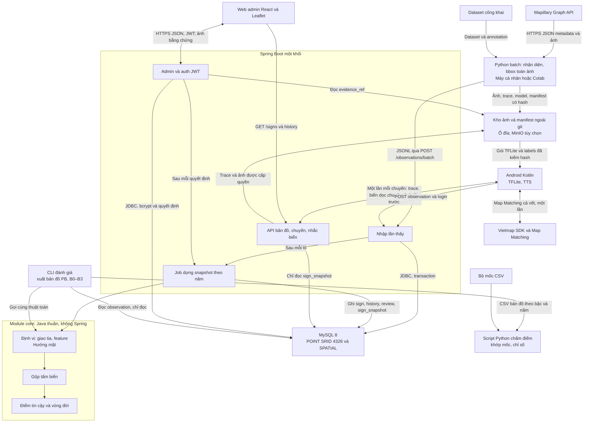
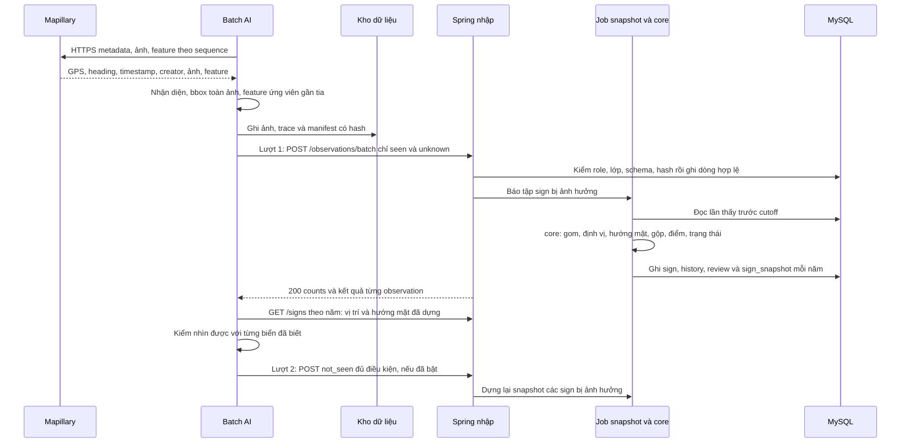
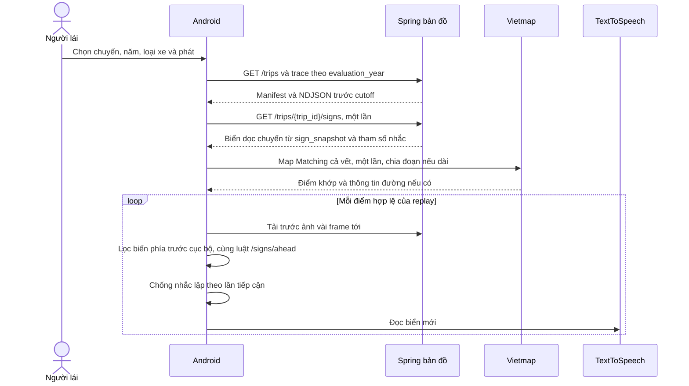
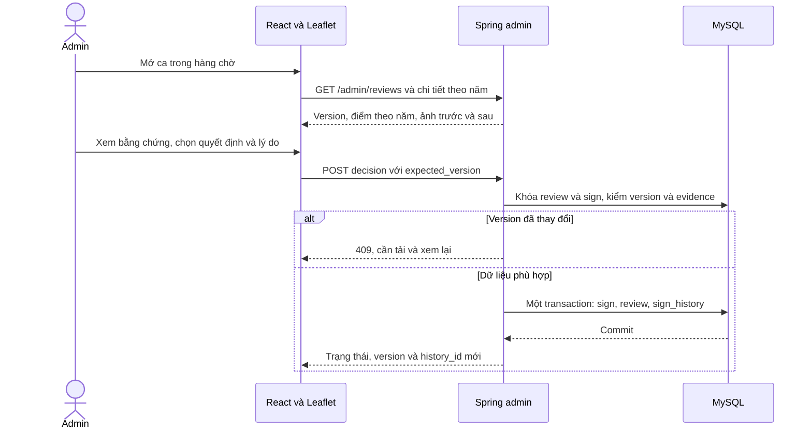
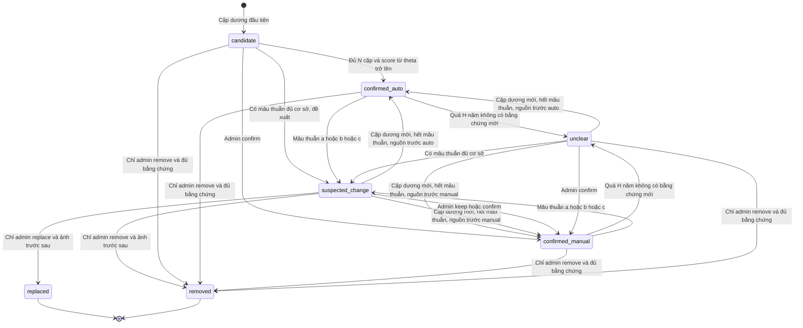
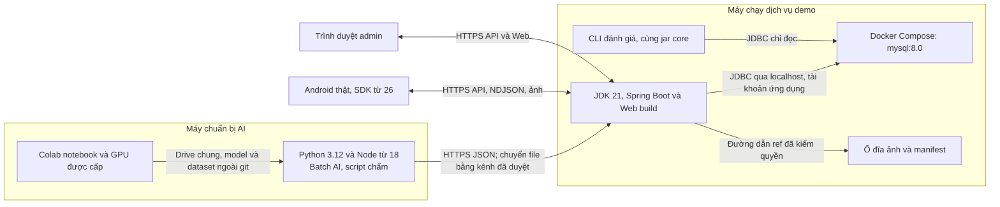

# Kiến trúc LiveSign

Thiết kế 1.1; chưa dựng project/dịch vụ. Nguồn API/CSDL/lớp/đơn vị ở
[contracts](contracts/api.md), thuật toán ở [algorithms.md](algorithms.md).
Một backend Spring Boot chia module; Python chạy batch/notebook, không là dịch vụ online.
Thuật toán lõi (định vị, hướng mặt, gộp, điểm tin cậy, vòng đời) viết **một lần** trong
module Java `core` không phụ thuộc Spring; dịch vụ và công cụ đánh giá cùng gọi module này.

## Bốn quyết định kiến trúc (1.2, chốt 19/10)

| Quyết định | Vì sao |
| --- | --- |
| **Một module `core` cho thuật toán + CLI đánh giá** dùng chung | Thang PB, B0–B3 phải chạy lại nhiều lần với tham số khác nhau. Viết thuật toán hai lần (Java cho dịch vụ, Python cho đánh giá) thì kết quả trong quyển có thể khác app. CLI xuất bản đồ ra CSV; script Python chỉ khớp bộ mốc và tính chỉ số |
| **Dựng sẵn snapshot theo năm** vào bảng `sign_snapshot` | Mọi API đều theo `evaluation_year`. Tính lại trong bộ nhớ ở mỗi request thì chậm và khó kiểm. Dựng sau mỗi lô nhập hoặc quyết định admin; API chỉ đọc |
| **Phát lại không gọi mạng theo từng điểm** | Tải biển dọc chuyến một lần (`GET /trips/{trip_id}/signs`), Map Matching cả vết một lần, app tự lọc biển phía trước cục bộ. Bớt độ trễ khi nhắc, bớt quota Vietmap, chạy được khi mạng chập chờn. `/signs/ahead` giữ làm bản tham chiếu để test đối chiếu |
| **Định vị nằm trong `core`, sau khi gom lần thấy** | Một ảnh không giao tia được. Batch AI chỉ gửi tư thế camera, bbox và feature Mapillary ứng viên; `core` gom các lần thấy cùng tấm rồi mới định vị, ước lượng hướng mặt và gộp |

## Thành phần và hợp đồng nối

Ingest kiểm quyền nội bộ trước xử lý; app/login được phục vụ bởi
module Admin/auth qua cùng base path `/api/v1`, không phải dịch vụ thứ hai.
Ảnh trong kho không công khai trực tiếp cả thư mục; API kiểm trip/sign/cutoff/role.
Gói model copy cục bộ có manifest, chưa thiết kế endpoint phát hành model tự động.

| Module | Trách nhiệm | Không nhận thêm trách nhiệm |
| --- | --- | --- |
| Nhập | Validate envelope/dòng, idempotency hash, trip, lưu bền; gọi job snapshot | Không tự gộp, không tự coi upload là bằng chứng mới |
| Job snapshot | Với mỗi evaluation_year: gọi `core`, ghi sign/history/review hiện tại và một lần chạy `sign_snapshot` | Không phục vụ request đọc |
| core: Định vị | Gom lần thấy cùng tấm → giao tia → feature Mapillary → camera_proxy; ước lượng hướng mặt | Không gọi CSDL hay HTTP; nhận dữ liệu, trả kết quả |
| core: Gộp | Liên kết observation→tấm, registry ổn định, nhiều tấm chung cột | Không quyết gỡ/thay |
| core: Tin cậy | Cặp người/năm, score/độ mới/mâu thuẫn, trạng thái | Không dùng confidence detector làm score |
| API bản đồ | Bbox, biển dọc chuyến, ahead, trip/ảnh/trace, sign/history — đọc `sign_snapshot` | Không tính lại điểm khi đọc |
| Admin/auth | bcrypt, JWT/role, quyết định có version, bằng chứng; gọi job snapshot | Không xóa observation/history để bác mâu thuẫn |
| CLI đánh giá | Chạy `core` trên observation trước cutoff với từng bậc/tham số, xuất CSV bản đồ | Không ghi vào CSDL dịch vụ |
| Script chấm (Python) | Khớp một–một với bộ mốc, precision/coverage/bootstrap, bảng cho quyển | Không định vị, gộp hay tính điểm lại |

## Nạp Mapillary đến bản đồ

Hai lượt là bắt buộc: not_seen cần vị trí và hướng mặt của biển, mà các giá trị này chỉ
có sau khi `core` gom các seen. Lô 1.0 là đồng bộ, chưa hứa job queue; ở quy mô một
tuyến demo, job snapshot chạy ngay sau lô. Nếu envelope sai từ chối cả lô; dòng sai trả
rejected, dòng hợp lệ lưu. Lỗi hệ thống giữa chừng: client retry cùng ID/hash. Quyết
định admin đồng thời được chặn bằng optimistic lock/version.

## Phát lại đến cảnh báo

Vòng lặp từng điểm không gọi API nhắc biển, nên độ trễ khi nhắc chủ yếu còn TTS và
khoảng cách giữa hai điểm GPS. App dùng tham số nhắc trả kèm response (không tự chép
số vào code). `/signs/ahead` vẫn giữ làm bản tham chiếu: test đối chiếu chạy cùng một
trace qua cả hai cách và yêu cầu ra cùng danh sách biển.

Map matching trả thông tin nào phải kiểm SDK/gói thực tế; chưa có bằng chứng có
cùng ID đường với CSDL. Không đoán road_ref từ tên phố. GPS nhảy/hướng thiếu/
map match không kiểm được được hiển thị unverified, không báo đã giải quyết biển đường song song.
TFLite có thể vẽ detection trên ảnh hiện tại; replay thuần không tự tạo cặp người mới.

## Admin duyệt ca

confirm/keep là xác nhận thủ công, defer giữ pending, remove/replace chỉ admin.
Biển thay mới có sign_id riêng; tạo candidate và xác nhận biển mới là hai thao tác
riêng theo API. Watermark đã duyệt là đề xuất còn mở, không xóa âm để làm tăng score.

## Vòng đời tấm biển

Sơ đồ rút gọn không bắt mọi replace phải đi qua suspected_change: quyền admin
1.0 có thể quyết từ ca hợp lệ của trạng thái khác; luôn cần biển thay riêng và
bằng chứng trước/sau. removed/replaced không tự hồi sinh. Không có nhánh tự động
đi vào hai trạng thái đó. Ưu tiên mâu thuẫn/cũ và hồi nguồn auto/manual vẫn là đề
xuất phải nhóm chốt như [algorithms.md](algorithms.md).

## Triển khai và biến môi trường

| Biến đã có trong .env.example | Nơi dùng / cách giữ |
| --- | --- |
| MAPILLARY_TOKEN | Tool/batch cá nhân; mỗi người riêng, không đưa vào URL hoặc app |
| VIETMAP_API_KEY | Cấu hình app qua local.properties/BuildConfig theo README; kiểm hạn chế key/quota |
| MYSQL_URL, MYSQL_USER, MYSQL_PASSWORD | Spring; user ứng dụng không root, SQL UTC |
| MYSQL_DATABASE, MYSQL_ROOT_PASSWORD, MYSQL_PORT | Compose khởi tạo; cổng bind 127.0.0.1 theo compose hiện có |
| GITHUB_TOKEN | Chỉ đọc repo, Colab Secrets; không ghi vào notebook output |
| SHARED_DRIVE_URL | Tham chiếu kho chia sẻ, không phải cơ chế auth server |
| PORT | Server gán nhãn hiện có, mặc định 8787; **không** tự dùng làm port Spring |

.env không tự thành environment Python/PowerShell. Không commit secret, ảnh/model
hoặc dữ liệu lớn. HTTP chỉ cho localhost/dev được kiểm soát; app trên điện thoại
cần base URL truy cập được, không gọi localhost của điện thoại để tìm backend máy tính.

**Cần nhóm quyết:** cấu hình JWT signing, đường dẫn kho ảnh và base URL app trước
triển khai. .env.example hiện chưa có các mục đó; đề xuất bổ sung bằng thay đổi cấu
hình riêng được duyệt, không hard-code secret hoặc tự thêm biến môi trường trong
lần chỉ viết tài liệu. HTTPS/phân quyền vẫn là yêu cầu, chưa được kiểm chứng đã cấu hình.

## Bất biến xuyên suốt

| Bất biến | Điểm kiểm |
| --- | --- |
| Một nguồn lớp | classes.yaml → dataset/model labels → sign_type/API → app; classes_version phải khớp |
| Cấu hình có phiên bản | params_version + config hash, không dùng một tên version che hai nội dung khác nhau |
| Snapshot theo năm | Lọc ảnh, liên kết tấm, tọa độ, điểm và admin trước cutoff; cache key đầy đủ |
| Ba kết quả | unknown không cập nhật α/β/độ mới; âm phải đủ kiểm nhìn được |
| Truy vết | creator/time gốc, image/sequence, observation/model version, history trước/sau |
| Phân biệt sản phẩm/chấm | unclear/suspected_change vẫn nhắc có nhãn; bị loại theo B2/B3 khi chấm |
| Ngoài git | Ảnh/dataset/model/credential ở kho riêng, repo giữ hợp đồng và mẫu nhỏ |

Ngoài phạm vi thiết kế triển khai lõi: Redis, RT-DETR/FastAPI, chức năng chỉ đường.
Vietmap Map Matching phục vụ khớp vết để lọc biển, không biến LiveSign thành app
dẫn đường. MinIO chỉ là lựa chọn kho sau khi ổ đĩa không đáp ứng hoặc điều kiện
phiếu giao đề tài được làm rõ; không thêm dịch vụ chỉ để đủ tên công nghệ.
