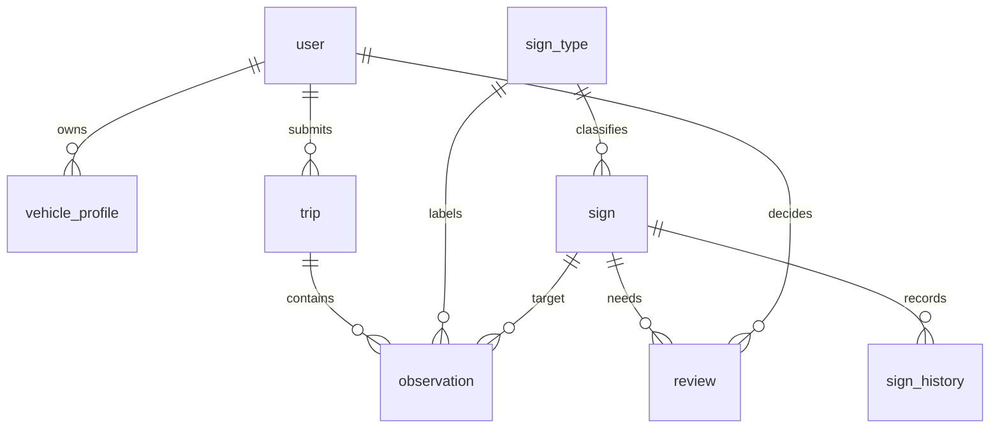

# CSDL MySQL 8 — SQL nháp

Đây là **DDL để review**, chưa phải migration Flyway và chưa được thực thi trên
MySQL trong lần chuẩn bị. MySQL 8.0, InnoDB,
UTF-8; mọi DATETIME lưu UTC, ID không phân biệt kiểu số/chuỗi từ bên ngoài: luôn string.
Danh mục sign_type được nạp từ [classes.yaml](../../ai/configs/classes.yaml), không
tự tạo một danh sách khác trong SQL. Chỉ có tám bảng nghiệp vụ được yêu cầu.

## Quan hệ và quy ước



- user là tài khoản app/admin/importer; `creator_id` là người chụp gốc,
  namespace `mapillary:<id>`, không FK đến user. Android replay giữ người chụp gốc.
- Cặp tính điểm là `(target_sign_id, creator_id, captured_year)`. Có seen thì dương;
  không seen nhưng có not_seen hợp lệ thì âm. Không đếm `unknown` hoặc `metadata_only`.
- `captured_at_precision=day`: nhận ngày, lưu 00:00:00 theo quy ước và giữ precision;
  xuất lại ngày, không khẳng định giờ chụp. Năm UTC là đề xuất cần nhóm xác nhận.
- sign.location là **vị trí biển ước lượng**, không phải vị trí camera.
  DTO xuất `sign_lon=ST_Longitude(location)`, `sign_lat=ST_Latitude(location)`.
  observation giữ các cột scalar cùng tên như file/API để giữ metadata thiếu của PoC.
- Ảnh/crop/model nằm ngoài git; `evidence_ref`, `trace_ref` trỏ kho dữ liệu do server
  quản lý. Không lưu bytes ảnh hoặc URL chứa token vào bảng.

## DDL dự thảo

```sql
SET time_zone = '+00:00';

CREATE TABLE `user` (
  user_id VARCHAR(160) PRIMARY KEY,
  username VARCHAR(80) NOT NULL UNIQUE,
  password_hash VARCHAR(255) NOT NULL,
  role ENUM('user','importer','admin') NOT NULL DEFAULT 'user',
  created_at DATETIME(3) NOT NULL DEFAULT CURRENT_TIMESTAMP(3)
) ENGINE=InnoDB DEFAULT CHARSET=utf8mb4 COLLATE=utf8mb4_0900_as_cs;

CREATE TABLE vehicle_profile (
  vehicle_profile_id VARCHAR(160) PRIMARY KEY,
  user_id VARCHAR(160) NOT NULL,
  vehicle_type ENUM('car','truck','motorcycle') NOT NULL,
  display_name VARCHAR(120) NOT NULL,
  created_at DATETIME(3) NOT NULL DEFAULT CURRENT_TIMESTAMP(3),
  CONSTRAINT fk_vehicle_user FOREIGN KEY (user_id) REFERENCES `user`(user_id)
) ENGINE=InnoDB DEFAULT CHARSET=utf8mb4 COLLATE=utf8mb4_0900_as_cs;

CREATE TABLE sign_type (
  sign_type_code VARCHAR(16) PRIMARY KEY,
  class_id SMALLINT UNSIGNED NOT NULL UNIQUE,
  classes_version VARCHAR(64) NOT NULL,
  name_vi VARCHAR(160) NOT NULL,
  sign_group ENUM('prohibition','warning','information') NOT NULL,
  vehicle_types JSON NOT NULL,
  CONSTRAINT ck_type_vehicles CHECK (JSON_TYPE(vehicle_types) = 'ARRAY')
) ENGINE=InnoDB DEFAULT CHARSET=utf8mb4 COLLATE=utf8mb4_0900_as_cs;

CREATE TABLE trip (
  trip_id VARCHAR(160) PRIMARY KEY,
  source ENUM('mapillary','android_replay') NOT NULL,
  sequence_id VARCHAR(128) NOT NULL,
  creator_id VARCHAR(128) NULL,
  user_id VARCHAR(160) NOT NULL,
  started_at DATETIME(3) NULL,
  ended_at DATETIME(3) NULL,
  trace_ref VARCHAR(512) NULL,
  created_at DATETIME(3) NOT NULL DEFAULT CURRENT_TIMESTAMP(3),
  INDEX ix_trip_source_sequence (source, sequence_id),
  INDEX ix_trip_creator (creator_id),
  CONSTRAINT fk_trip_user FOREIGN KEY (user_id) REFERENCES `user`(user_id),
  CONSTRAINT ck_trip_time CHECK (ended_at IS NULL OR started_at IS NULL OR ended_at >= started_at)
) ENGINE=InnoDB DEFAULT CHARSET=utf8mb4 COLLATE=utf8mb4_0900_as_cs;

CREATE TABLE sign (
  sign_id VARCHAR(160) PRIMARY KEY,
  sign_type_code VARCHAR(16) NOT NULL,
  location POINT NOT NULL SRID 4326,
  sign_facing_deg DOUBLE NULL,
  road_ref VARCHAR(255) NULL,
  status ENUM('candidate','confirmed_auto','confirmed_manual','unclear',
              'suspected_change','removed','replaced') NOT NULL DEFAULT 'candidate',
  replacement_sign_id VARCHAR(160) NULL,
  as_of_year SMALLINT UNSIGNED NULL,
  alpha DECIMAL(18,9) NOT NULL DEFAULT 1,
  beta DECIMAL(18,9) NOT NULL DEFAULT 1,
  agreement_score DECIMAL(10,9) NOT NULL DEFAULT 0.5,
  positive_pair_count INT UNSIGNED NOT NULL DEFAULT 0,
  negative_pair_count INT UNSIGNED NOT NULL DEFAULT 0,
  last_seen_at DATETIME(3) NULL,
  last_evidence_at DATETIME(3) NULL,
  conflict_reasons JSON NOT NULL,
  params_version VARCHAR(64) NOT NULL,
  version INT UNSIGNED NOT NULL DEFAULT 1,
  created_at DATETIME(3) NOT NULL DEFAULT CURRENT_TIMESTAMP(3),
  updated_at DATETIME(3) NOT NULL DEFAULT CURRENT_TIMESTAMP(3) ON UPDATE CURRENT_TIMESTAMP(3),
  SPATIAL INDEX sx_sign_location (location),
  INDEX ix_sign_state_type (status, sign_type_code),
  CONSTRAINT fk_sign_type FOREIGN KEY (sign_type_code) REFERENCES sign_type(sign_type_code),
  CONSTRAINT fk_sign_replacement FOREIGN KEY (replacement_sign_id) REFERENCES sign(sign_id),
  CONSTRAINT ck_sign_direction CHECK (sign_facing_deg IS NULL OR (sign_facing_deg >= 0 AND sign_facing_deg < 360)),
  CONSTRAINT ck_sign_score CHECK (alpha >= 1 AND beta >= 1 AND agreement_score BETWEEN 0 AND 1),
  CONSTRAINT ck_sign_replacement CHECK (replacement_sign_id IS NULL OR replacement_sign_id <> sign_id),
  CONSTRAINT ck_sign_replaced CHECK (status <> 'replaced' OR replacement_sign_id IS NOT NULL),
  CONSTRAINT ck_sign_conflicts CHECK (JSON_TYPE(conflict_reasons) = 'ARRAY')
) ENGINE=InnoDB DEFAULT CHARSET=utf8mb4 COLLATE=utf8mb4_0900_as_cs;

CREATE TABLE observation (
  observation_id VARCHAR(160) PRIMARY KEY,
  schema_version VARCHAR(16) NOT NULL,
  classes_version VARCHAR(64) NOT NULL,
  payload_sha256 CHAR(64) NOT NULL,
  source ENUM('mapillary','android_replay') NOT NULL,
  trip_id VARCHAR(160) NOT NULL,
  sequence_id VARCHAR(128) NOT NULL,
  creator_id VARCHAR(128) NULL,
  captured_at DATETIME(3) NOT NULL,
  captured_at_precision ENUM('instant','day') NOT NULL,
  captured_year SMALLINT UNSIGNED GENERATED ALWAYS AS (YEAR(captured_at)) STORED,
  image_id VARCHAR(128) NOT NULL,
  target_sign_id VARCHAR(160) NULL,
  source_sign_id VARCHAR(128) NULL,
  source_sign_type VARCHAR(160) NULL,
  sign_type_code VARCHAR(16) NULL,
  camera_lon DOUBLE NULL,
  camera_lat DOUBLE NULL,
  camera_heading_deg DOUBLE NULL,
  sign_lon DOUBLE NULL,
  sign_lat DOUBLE NULL,
  sign_facing_deg DOUBLE NULL,
  distance_m DOUBLE NULL,
  off_deg DOUBLE NULL,
  is_pano BOOLEAN NULL,
  focal DOUBLE NULL,
  image_width_px INT UNSIGNED NULL,
  image_height_px INT UNSIGNED NULL,
  bbox_px JSON NULL,
  detector_confidence DOUBLE NULL,
  outcome ENUM('seen','not_seen','unknown') NOT NULL,
  in_fov BOOLEAN NULL,
  facing_camera BOOLEAN NULL,
  sharp BOOLEAN NULL,
  unoccluded BOOLEAN NULL,
  visibility_method ENUM('unverified','independent_model_audited','human','automatic_rules') NOT NULL,
  model_version VARCHAR(128) NULL,
  evidence_ref VARCHAR(512) NULL,
  source_metadata JSON NULL,
  ingest_status ENUM('accepted','metadata_only') NOT NULL,
  uploaded_by VARCHAR(160) NOT NULL,
  created_at DATETIME(3) NOT NULL DEFAULT CURRENT_TIMESTAMP(3),
  INDEX ix_observation_pair (target_sign_id, creator_id, captured_year, outcome, captured_at),
  INDEX ix_observation_time (captured_at),
  INDEX ix_observation_image (source, image_id),
  CONSTRAINT fk_observation_trip FOREIGN KEY (trip_id) REFERENCES trip(trip_id),
  CONSTRAINT fk_observation_sign FOREIGN KEY (target_sign_id) REFERENCES sign(sign_id),
  CONSTRAINT fk_observation_type FOREIGN KEY (sign_type_code) REFERENCES sign_type(sign_type_code),
  CONSTRAINT fk_observation_uploader FOREIGN KEY (uploaded_by) REFERENCES `user`(user_id),
  CONSTRAINT ck_observation_conf CHECK (detector_confidence IS NULL OR detector_confidence BETWEEN 0 AND 1),
  CONSTRAINT ck_observation_camera CHECK (
    (camera_lon IS NULL AND camera_lat IS NULL) OR
    (camera_lon IS NOT NULL AND camera_lat IS NOT NULL AND camera_lon BETWEEN -180 AND 180 AND camera_lat BETWEEN -90 AND 90)),
  CONSTRAINT ck_observation_sign_coord CHECK (
    (sign_lon IS NULL AND sign_lat IS NULL) OR
    (sign_lon IS NOT NULL AND sign_lat IS NOT NULL AND sign_lon BETWEEN -180 AND 180 AND sign_lat BETWEEN -90 AND 90)),
  CONSTRAINT ck_observation_heading CHECK (camera_heading_deg IS NULL OR (camera_heading_deg >= 0 AND camera_heading_deg < 360)),
  CONSTRAINT ck_observation_facing CHECK (sign_facing_deg IS NULL OR (sign_facing_deg >= 0 AND sign_facing_deg < 360)),
  CONSTRAINT ck_observation_off CHECK (off_deg IS NULL OR (off_deg >= -180 AND off_deg < 180)),
  CONSTRAINT ck_observation_distance CHECK (distance_m IS NULL OR distance_m >= 0),
  CONSTRAINT ck_observation_focal CHECK (focal IS NULL OR focal > 0),
  CONSTRAINT ck_observation_image_size CHECK (
    (image_width_px IS NULL AND image_height_px IS NULL) OR
    (image_width_px IS NOT NULL AND image_height_px IS NOT NULL AND image_width_px > 0 AND image_height_px > 0)),
  CONSTRAINT ck_observation_metadata_only CHECK (ingest_status <> 'metadata_only' OR outcome = 'unknown'),
  CONSTRAINT ck_observation_seen CHECK (outcome <> 'seen' OR
    (sign_type_code IS NOT NULL AND bbox_px IS NOT NULL AND detector_confidence IS NOT NULL
     AND model_version IS NOT NULL AND image_width_px IS NOT NULL AND image_height_px IS NOT NULL)),
  CONSTRAINT ck_observation_negative CHECK (outcome <> 'not_seen' OR
    (target_sign_id IS NOT NULL AND sign_type_code IS NOT NULL AND creator_id IS NOT NULL
     AND camera_lon IS NOT NULL AND camera_lat IS NOT NULL AND camera_heading_deg IS NOT NULL
     AND sign_lon IS NOT NULL AND sign_lat IS NOT NULL AND sign_facing_deg IS NOT NULL
     AND distance_m IS NOT NULL AND distance_m <= 30
     AND in_fov IS TRUE AND facing_camera IS TRUE AND sharp IS TRUE AND unoccluded IS TRUE
     AND bbox_px IS NULL AND detector_confidence IS NULL AND model_version IS NOT NULL))
) ENGINE=InnoDB DEFAULT CHARSET=utf8mb4 COLLATE=utf8mb4_0900_as_cs;

CREATE TABLE sign_history (
  history_id VARCHAR(160) PRIMARY KEY,
  sign_id VARCHAR(160) NOT NULL,
  event_type ENUM('state_changed','type_changed','admin_decision','score_updated') NOT NULL,
  old_status VARCHAR(32) NULL,
  new_status VARCHAR(32) NOT NULL,
  old_sign_type_code VARCHAR(16) NULL,
  new_sign_type_code VARCHAR(16) NOT NULL,
  before_snapshot JSON NULL,
  after_snapshot JSON NOT NULL,
  before_observation_id VARCHAR(160) NULL,
  after_observation_id VARCHAR(160) NULL,
  changed_by VARCHAR(160) NULL,
  effective_at DATETIME(3) NOT NULL,
  recorded_at DATETIME(3) NOT NULL DEFAULT CURRENT_TIMESTAMP(3),
  reason TEXT NOT NULL,
  INDEX ix_history_sign_time (sign_id, effective_at, recorded_at),
  CONSTRAINT fk_history_sign FOREIGN KEY (sign_id) REFERENCES sign(sign_id),
  CONSTRAINT fk_history_old_type FOREIGN KEY (old_sign_type_code) REFERENCES sign_type(sign_type_code),
  CONSTRAINT fk_history_new_type FOREIGN KEY (new_sign_type_code) REFERENCES sign_type(sign_type_code),
  CONSTRAINT fk_history_before FOREIGN KEY (before_observation_id) REFERENCES observation(observation_id),
  CONSTRAINT fk_history_after FOREIGN KEY (after_observation_id) REFERENCES observation(observation_id),
  CONSTRAINT fk_history_user FOREIGN KEY (changed_by) REFERENCES `user`(user_id)
) ENGINE=InnoDB DEFAULT CHARSET=utf8mb4 COLLATE=utf8mb4_0900_as_cs;

CREATE TABLE review (
  review_id VARCHAR(160) PRIMARY KEY,
  sign_id VARCHAR(160) NOT NULL,
  status ENUM('pending','decided') NOT NULL DEFAULT 'pending',
  conflict_reasons JSON NOT NULL,
  before_observation_id VARCHAR(160) NULL,
  after_observation_id VARCHAR(160) NULL,
  decision ENUM('confirm','keep','remove','replace','defer') NULL,
  replacement_sign_id VARCHAR(160) NULL,
  reporter_id VARCHAR(160) NULL,
  decided_by VARCHAR(160) NULL,
  reason TEXT NULL,
  effective_at DATETIME(3) NULL,
  decided_at DATETIME(3) NULL,
  created_at DATETIME(3) NOT NULL DEFAULT CURRENT_TIMESTAMP(3),
  version INT UNSIGNED NOT NULL DEFAULT 1,
  pending_sign_id VARCHAR(160) GENERATED ALWAYS AS (CASE WHEN status = 'pending' THEN sign_id ELSE NULL END) STORED,
  UNIQUE KEY uq_review_pending (pending_sign_id),
  INDEX ix_review_queue (status, created_at, review_id),
  CONSTRAINT fk_review_sign FOREIGN KEY (sign_id) REFERENCES sign(sign_id),
  CONSTRAINT fk_review_before FOREIGN KEY (before_observation_id) REFERENCES observation(observation_id),
  CONSTRAINT fk_review_after FOREIGN KEY (after_observation_id) REFERENCES observation(observation_id),
  CONSTRAINT fk_review_replacement FOREIGN KEY (replacement_sign_id) REFERENCES sign(sign_id),
  CONSTRAINT fk_review_reporter FOREIGN KEY (reporter_id) REFERENCES `user`(user_id),
  CONSTRAINT fk_review_admin FOREIGN KEY (decided_by) REFERENCES `user`(user_id),
  CONSTRAINT ck_review_replace CHECK (decision <> 'replace' OR
    (replacement_sign_id IS NOT NULL AND replacement_sign_id <> sign_id)),
  CONSTRAINT ck_review_decided CHECK (status <> 'decided' OR
    (decision IS NOT NULL AND decision <> 'defer' AND decided_by IS NOT NULL AND decided_at IS NOT NULL
     AND effective_at IS NOT NULL AND reason IS NOT NULL))
) ENGINE=InnoDB DEFAULT CHARSET=utf8mb4 COLLATE=utf8mb4_0900_as_cs;
```

## Những ràng buộc thuộc service

CHECK không thay hợp đồng: service kiểm tra enum boolean thực, bbox 4 số hữu hạn trong
ảnh, geometry/distance nhất quán, focal/camera khi tạo âm, quyền admin, trip/creator/sequence
khớp envelope, và `negative_evidence_enabled`. Độ lệch góc gộp ở params, không hard-code SQL.
`payload_sha256` tính trên request chuẩn hóa trước khi server gán target, dùng chống
gửi lại ID với nội dung khác. Khóa khác ID nhưng cùng ảnh gốc/target/model phải được
đối chiếu, đặc biệt khi Android phát lại dữ liệu AI đã nhập.

`sign` là cache hiện tại; muốn chấm năm cũ phải tính lại từ observation trước cutoff
và lịch sử thích hợp. `after_snapshot` lưu đủ loại/vị trí/hướng/trạng thái/reliability,
`as_of_year` và `params_version`; không chỉ lưu mỗi status. Bảng history append-only
ở service. Không xóa vật lý sign khi admin quyết gỡ/thay; tạo sign mới cho tấm thay thế.
Mọi quyết định lưu cùng transaction với sign/history, dùng compare-and-set `version`.
Các bản đồ B0–B3 chấm tự động trước admin; phần sau admin báo riêng, không dùng quyết
định biết từ ảnh tương lai để làm đẹp bản đồ quá khứ.

## Không đảo kinh độ/vĩ độ trong MySQL

`POINT NOT NULL SRID 4326` cho phép SPATIAL index dùng đúng SRS.
MySQL mặc định thứ tự trục theo SRS; với WKT `[lon lat]` phải ghi rõ option:

```sql
SET @p = ST_GeomFromText('POINT(105.84715 21.02537)', 4326, 'axis-order=long-lat');
SELECT ST_SRID(@p), ST_Longitude(@p) AS sign_lon, ST_Latitude(@p) AS sign_lat;
SELECT ST_AsText(@p, 'axis-order=long-lat');
```

Truy vấn bbox dùng MBR để lọc sơ bộ, rồi lọc chính xác; tính khoảng cách trên SRS địa lý
và xác nhận đơn vị mét. Không dùng `ST_X`/`ST_Y` nếu chưa xác định thứ tự trục ở driver.
Xem [spatial types](https://dev.mysql.com/doc/refman/8.0/en/spatial-type-overview.html)
và [axis order của MySQL](https://dev.mysql.com/blog-archive/axis-order-in-spatial-reference-systems/).

## Tiêu chí duyệt DDL

Chạy trên MySQL 8 sau khi Docker sẵn sàng: tám bảng tạo được, FK sai bị từ chối,
khác hoa/thường ở sequence/ID không bị gộp; kiểm tra `SHOW CREATE TABLE sign` và
`SHOW INDEX FROM sign` có SRID/SPATIAL. Thử điểm trên trả lon=105,84715/lat=21,02537.
Thử hai người/nhiều chuyến cùng năm chỉ tạo đúng hai cặp; unknown không thay α/β;
đổi loại/gỡ có ảnh trước/sau và history; snapshot 2023 không đọc observation 2024.
