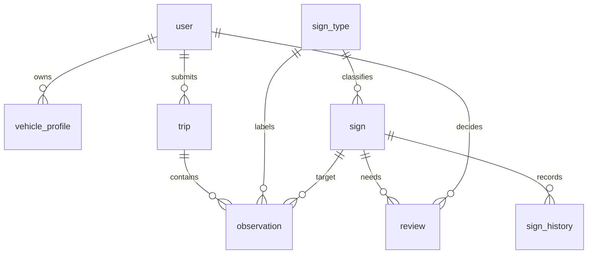

# CSDL MySQL 8 — SQL nháp

Đây là **DDL để review**, chưa phải migration Flyway và chưa được thực thi trên
MySQL trong lần chuẩn bị. MySQL 8.0, InnoDB,
UTF-8; mọi DATETIME lưu UTC, ID không phân biệt kiểu số/chuỗi từ bên ngoài: luôn string.
Danh mục sign_type được nạp từ [classes.yaml](../../ai/configs/classes.yaml), không
tự tạo một danh sách khác trong SQL. Chỉ có tám bảng nghiệp vụ được yêu cầu.

## Quan hệ và quy ước



- user là tài khoản app/admin/importer; `creator_id` là người chụp gốc,
  namespace `mapillary:<id>`, không FK đến user. Android replay giữ người chụp gốc.
- Cặp tính điểm là `(target_sign_id, creator_id, captured_year)`. Có seen thì dương;
  không seen nhưng có not_seen hợp lệ thì âm. Không đếm `unknown` hoặc `metadata_only`.
- `captured_at_precision=day`: nhận ngày, lưu 00:00:00 theo quy ước và giữ precision;
  xuất lại ngày, không khẳng định giờ chụp. Năm UTC là đề xuất cần nhóm xác nhận.
- sign.location là **vị trí biển ước lượng**, không phải vị trí camera.
  DTO xuất `sign_lon=ST_Longitude(location)`, `sign_lat=ST_Latitude(location)`.
  observation giữ các cột scalar cùng tên như file/API để giữ metadata thiếu của PoC.
- Ảnh/crop/model nằm ngoài git; `evidence_ref`, `trace_ref` trỏ kho dữ liệu do server
  quản lý. Không lưu bytes ảnh hoặc URL chứa token vào bảng.

## DDL dự thảo

```sql
SET time_zone = '+00:00';

CREATE TABLE `user` (
  user_id VARCHAR(160) PRIMARY KEY,
  username VARCHAR(80) NOT NULL UNIQUE,
  password_hash VARCHAR(255) NOT NULL,
  role ENUM('user','importer','admin') NOT NULL DEFAULT 'user',
  created_at DATETIME(3) NOT NULL DEFAULT CURRENT_TIMESTAMP(3)
) ENGINE=InnoDB DEFAULT CHARSET=utf8mb4 COLLATE=utf8mb4_0900_as_cs;

CREATE TABLE vehicle_profile (
  vehicle_profile_id VARCHAR(160) PRIMARY KEY,
  user_id VARCHAR(160) NOT NULL,
  vehicle_type ENUM('car','truck','motorcycle') NOT NULL,
  display_name VARCHAR(120) NOT NULL,
  created_at DATETIME(3) NOT NULL DEFAULT CURRENT_TIMESTAMP(3),
  CONSTRAINT fk_vehicle_user FOREIGN KEY (user_id) REFERENCES `user`(user_id)
) ENGINE=InnoDB DEFAULT CHARSET=utf8mb4 COLLATE=utf8mb4_0900_as_cs;

CREATE TABLE sign_type (
  sign_type_code VARCHAR(16) PRIMARY KEY,
  class_id SMALLINT UNSIGNED NOT NULL UNIQUE,
  classes_version VARCHAR(64) NOT NULL,
  name_vi VARCHAR(160) NOT NULL,
  sign_group ENUM('prohibition','warning','information') NOT NULL,
  vehicle_types JSON NOT NULL,
  CONSTRAINT ck_type_vehicles CHECK (JSON_TYPE(vehicle_types) = 'ARRAY')
) ENGINE=InnoDB DEFAULT CHARSET=utf8mb4 COLLATE=utf8mb4_0900_as_cs;

CREATE TABLE trip (
  trip_id VARCHAR(160) PRIMARY KEY,
  source ENUM('mapillary','android_replay') NOT NULL,
  sequence_id VARCHAR(128) NOT NULL,
  creator_id VARCHAR(128) NULL,
  user_id VARCHAR(160) NOT NULL,
  started_at DATETIME(3) NULL,
  ended_at DATETIME(3) NULL,
  trace_ref VARCHAR(512) NULL,
  created_at DATETIME(3) NOT NULL DEFAULT CURRENT_TIMESTAMP(3),
  INDEX ix_trip_source_sequence (source, sequence_id),
  INDEX ix_trip_creator (creator_id),
  CONSTRAINT fk_trip_user FOREIGN KEY (user_id) REFERENCES `user`(user_id),
  CONSTRAINT ck_trip_time CHECK (ended_at IS NULL OR started_at IS NULL OR ended_at >= started_at)
) ENGINE=InnoDB DEFAULT CHARSET=utf8mb4 COLLATE=utf8mb4_0900_as_cs;

CREATE TABLE sign (
  sign_id VARCHAR(160) PRIMARY KEY,
  sign_type_code VARCHAR(16) NOT NULL,
  location POINT NOT NULL SRID 4326,
  sign_facing_deg DOUBLE NULL,
  road_ref VARCHAR(255) NULL,
  status ENUM('candidate','confirmed_auto','confirmed_manual','unclear',
              'suspected_change','removed','replaced') NOT NULL DEFAULT 'candidate',
  replacement_sign_id VARCHAR(160) NULL,
  as_of_year SMALLINT UNSIGNED NULL,
  alpha DECIMAL(18,9) NOT NULL DEFAULT 1,
  beta DECIMAL(18,9) NOT NULL DEFAULT 1,
  agreement_score DECIMAL(10,9) NOT NULL DEFAULT 0.5,
  positive_pair_count INT UNSIGNED NOT NULL DEFAULT 0,
  negative_pair_count INT UNSIGNED NOT NULL DEFAULT 0,
  last_seen_at DATETIME(3) NULL,
  last_evidence_at DATETIME(3) NULL,
  conflict_reasons JSON NOT NULL,
  params_version VARCHAR(64) NOT NULL,
  version INT UNSIGNED NOT NULL DEFAULT 1,
  created_at DATETIME(3) NOT NULL DEFAULT CURRENT_TIMESTAMP(3),
  updated_at DATETIME(3) NOT NULL DEFAULT CURRENT_TIMESTAMP(3) ON UPDATE CURRENT_TIMESTAMP(3),
  SPATIAL INDEX sx_sign_location (location),
  INDEX ix_sign_state_type (status, sign_type_code),
  CONSTRAINT fk_sign_type FOREIGN KEY (sign_type_code) REFERENCES sign_type(sign_type_code),
  CONSTRAINT fk_sign_replacement FOREIGN KEY (replacement_sign_id) REFERENCES sign(sign_id),
  CONSTRAINT ck_sign_direction CHECK (sign_facing_deg IS NULL OR (sign_facing_deg >= 0 AND sign_facing_deg < 360)),
  CONSTRAINT ck_sign_score CHECK (alpha >= 1 AND beta >= 1 AND agreement_score BETWEEN 0 AND 1),
  CONSTRAINT ck_sign_replacement CHECK (replacement_sign_id IS NULL OR replacement_sign_id <> sign_id),
  CONSTRAINT ck_sign_replaced CHECK (status <> 'replaced' OR replacement_sign_id IS NOT NULL),
  CONSTRAINT ck_sign_conflicts CHECK (JSON_TYPE(conflict_reasons) = 'ARRAY')
) ENGINE=InnoDB DEFAULT CHARSET=utf8mb4 COLLATE=utf8mb4_0900_as_cs;

CREATE TABLE observation (
  observation_id VARCHAR(160) PRIMARY KEY,
  schema_version VARCHAR(16) NOT NULL,
  classes_version VARCHAR(64) NOT NULL,
  payload_sha256 CHAR(64) NOT NULL,
  source ENUM('mapillary','android_replay') NOT NULL,
  trip_id VARCHAR(160) NOT NULL,
  sequence_id VARCHAR(128) NOT NULL,
  creator_id VARCHAR(128) NULL,
  captured_at DATETIME(3) NOT NULL,
  captured_at_precision ENUM('instant','day') NOT NULL,
  captured_year SMALLINT UNSIGNED GENERATED ALWAYS AS (YEAR(captured_at)) STORED,
  image_id VARCHAR(128) NOT NULL,
  target_sign_id VARCHAR(160) NULL,
  source_sign_id VARCHAR(128) NULL,
  source_sign_type VARCHAR(160) NULL,
  sign_type_code VARCHAR(16) NULL,
  camera_lon DOUBLE NULL,
  camera_lat DOUBLE NULL,
  camera_heading_deg DOUBLE NULL,
  sign_lon DOUBLE NULL,
  sign_lat DOUBLE NULL,
  sign_facing_deg DOUBLE NULL,
  distance_m DOUBLE NULL,
  off_deg DOUBLE NULL,
  is_pano BOOLEAN NULL,
  focal DOUBLE NULL,
  image_width_px INT UNSIGNED NULL,
  image_height_px INT UNSIGNED NULL,
  bbox_px JSON NULL,
  detector_confidence DOUBLE NULL,
  outcome ENUM('seen','not_seen','unknown') NOT NULL,
  in_fov BOOLEAN NULL,
  facing_camera BOOLEAN NULL,
  sharp BOOLEAN NULL,
  unoccluded BOOLEAN NULL,
  visibility_method ENUM('unverified','independent_model_audited','human','automatic_rules') NOT NULL,
  model_version VARCHAR(128) NULL,
  evidence_ref VARCHAR(512) NULL,
  source_metadata JSON NULL,
  ingest_status ENUM('accepted','metadata_only') NOT NULL,
  uploaded_by VARCHAR(160) NOT NULL,
  created_at DATETIME(3) NOT NULL DEFAULT CURRENT_TIMESTAMP(3),
  INDEX ix_observation_pair (target_sign_id, creator_id, captured_year, outcome, captured_at),
  INDEX ix_observation_time (captured_at),
  INDEX ix_observation_image (source, image_id),
  CONSTRAINT fk_observation_trip FOREIGN KEY (trip_id) REFERENCES trip(trip_id),
  CONSTRAINT fk_observation_sign FOREIGN KEY (target_sign_id) REFERENCES sign(sign_id),
  CONSTRAINT fk_observation_type FOREIGN KEY (sign_type_code) REFERENCES sign_type(sign_type_code),
  CONSTRAINT fk_observation_uploader FOREIGN KEY (uploaded_by) REFERENCES `user`(user_id),
  CONSTRAINT ck_observation_conf CHECK (detector_confidence IS NULL OR detector_confidence BETWEEN 0 AND 1),
  CONSTRAINT ck_observation_camera CHECK (
    (camera_lon IS NULL AND camera_lat IS NULL) OR
    (camera_lon IS NOT NULL AND camera_lat IS NOT NULL AND camera_lon BETWEEN -180 AND 180 AND camera_lat BETWEEN -90 AND 90)),
  CONSTRAINT ck_observation_sign_coord CHECK (
    (sign_lon IS NULL AND sign_lat IS NULL) OR
    (sign_lon IS NOT NULL AND sign_lat IS NOT NULL AND sign_lon BETWEEN -180 AND 180 AND sign_lat BETWEEN -90 AND 90)),
  CONSTRAINT ck_observation_heading CHECK (camera_heading_deg IS NULL OR (camera_heading_deg >= 0 AND camera_heading_deg < 360)),
  CONSTRAINT ck_observation_facing CHECK (sign_facing_deg IS NULL OR (sign_facing_deg >= 0 AND sign_facing_deg < 360)),
  CONSTRAINT ck_observation_off CHECK (off_deg IS NULL OR (off_deg >= -180 AND off_deg < 180)),
  CONSTRAINT ck_observation_distance CHECK (distance_m IS NULL OR distance_m >= 0),
  CONSTRAINT ck_observation_focal CHECK (focal IS NULL OR focal > 0),
  CONSTRAINT ck_observation_image_size CHECK (
    (image_width_px IS NULL AND image_height_px IS NULL) OR
    (image_width_px IS NOT NULL AND image_height_px IS NOT NULL AND image_width_px > 0 AND image_height_px > 0)),
  CONSTRAINT ck_observation_metadata_only CHECK (ingest_status <> 'metadata_only' OR outcome = 'unknown'),
  CONSTRAINT ck_observation_seen CHECK (outcome <> 'seen' OR
    (sign_type_code IS NOT NULL AND bbox_px IS NOT NULL AND detector_confidence IS NOT NULL
     AND model_version IS NOT NULL AND image_width_px IS NOT NULL AND image_height_px IS NOT NULL)),
  CONSTRAINT ck_observation_negative CHECK (outcome <> 'not_seen' OR
    (target_sign_id IS NOT NULL AND sign_type_code IS NOT NULL AND creator_id IS NOT NULL
     AND camera_lon IS NOT NULL AND camera_lat IS NOT NULL AND camera_heading_deg IS NOT NULL
     AND sign_lon IS NOT NULL AND sign_lat IS NOT NULL AND sign_facing_deg IS NOT NULL
     AND distance_m IS NOT NULL AND distance_m <= 30
     AND in_fov IS TRUE AND facing_camera IS TRUE AND sharp IS TRUE AND unoccluded IS TRUE
     AND bbox_px IS NULL AND detector_confidence IS NULL AND model_version IS NOT NULL))
) ENGINE=InnoDB DEFAULT CHARSET=utf8mb4 COLLATE=utf8mb4_0900_as_cs;

CREATE TABLE sign_history (
  history_id VARCHAR(160) PRIMARY KEY,
  sign_id VARCHAR(160) NOT NULL,
  event_type ENUM('state_changed','type_changed','admin_decision','score_updated') NOT NULL,
  old_status VARCHAR(32) NULL,
  new_status VARCHAR(32) NOT NULL,
  old_sign_type_code VARCHAR(16) NULL,
  new_sign_type_code VARCHAR(16) NOT NULL,
  before_snapshot JSON NULL,
  after_snapshot JSON NOT NULL,
  before_observation_id VARCHAR(160) NULL,
  after_observation_id VARCHAR(160) NULL,
  changed_by VARCHAR(160) NULL,
  effective_at DATETIME(3) NOT NULL,
  recorded_at DATETIME(3) NOT NULL DEFAULT CURRENT_TIMESTAMP(3),
  reason TEXT NOT NULL,
  INDEX ix_history_sign_time (sign_id, effective_at, recorded_at),
  CONSTRAINT fk_history_sign FOREIGN KEY (sign_id) REFERENCES sign(sign_id),
  CONSTRAINT fk_history_old_type FOREIGN KEY (old_sign_type_code) REFERENCES sign_type(sign_type_code),
  CONSTRAINT fk_history_new_type FOREIGN KEY (new_sign_type_code) REFERENCES sign_type(sign_type_code),
  CONSTRAINT fk_history_before FOREIGN KEY (before_observation_id) REFERENCES observation(observation_id),
  CONSTRAINT fk_history_after FOREIGN KEY (after_observation_id) REFERENCES observation(observation_id),
  CONSTRAINT fk_history_user FOREIGN KEY (changed_by) REFERENCES `user`(user_id)
) ENGINE=InnoDB DEFAULT CHARSET=utf8mb4 COLLATE=utf8mb4_0900_as_cs;

CREATE TABLE review (
  review_id VARCHAR(160) PRIMARY KEY,
  sign_id VARCHAR(160) NOT NULL,
  status ENUM('pending','decided') NOT NULL DEFAULT 'pending',
  conflict_reasons JSON NOT NULL,
  before_observation_id VARCHAR(160) NULL,
  after_observation_id VARCHAR(160) NULL,
  decision ENUM('confirm','keep','remove','replace','defer') NULL,
  replacement_sign_id VARCHAR(160) NULL,
  reporter_id VARCHAR(160) NULL,
  decided_by VARCHAR(160) NULL,
  reason TEXT NULL,
  effective_at DATETIME(3) NULL,
  decided_at DATETIME(3) NULL,
  created_at DATETIME(3) NOT NULL DEFAULT CURRENT_TIMESTAMP(3),
  version INT UNSIGNED NOT NULL DEFAULT 1,
  pending_sign_id VARCHAR(160) GENERATED ALWAYS AS (CASE WHEN status = 'pending' THEN sign_id ELSE NULL END) STORED,
  UNIQUE KEY uq_review_pending (pending_sign_id),
  INDEX ix_review_queue (status, created_at, review_id),
  CONSTRAINT fk_review_sign FOREIGN KEY (sign_id) REFERENCES sign(sign_id),
  CONSTRAINT fk_review_before FOREIGN KEY (before_observation_id) REFERENCES observation(observation_id),
  CONSTRAINT fk_review_after FOREIGN KEY (after_observation_id) REFERENCES observation(observation_id),
  CONSTRAINT fk_review_replacement FOREIGN KEY (replacement_sign_id) REFERENCES sign(sign_id),
  CONSTRAINT fk_review_reporter FOREIGN KEY (reporter_id) REFERENCES `user`(user_id),
  CONSTRAINT fk_review_admin FOREIGN KEY (decided_by) REFERENCES `user`(user_id),
  CONSTRAINT ck_review_replace CHECK (decision <> 'replace' OR
    (replacement_sign_id IS NOT NULL AND replacement_sign_id <> sign_id)),
  CONSTRAINT ck_review_decided CHECK (status <> 'decided' OR
    (decision IS NOT NULL AND decision <> 'defer' AND decided_by IS NOT NULL AND decided_at IS NOT NULL
     AND effective_at IS NOT NULL AND reason IS NOT NULL))
) ENGINE=InnoDB DEFAULT CHARSET=utf8mb4 COLLATE=utf8mb4_0900_as_cs;
```

## Những ràng buộc thuộc service

CHECK không thay hợp đồng: service kiểm tra enum boolean thực, bbox 4 số hữu hạn trong
ảnh, geometry/distance nhất quán, focal/camera khi tạo âm, quyền admin, trip/creator/sequence
khớp envelope, và `negative_evidence_enabled`. Độ lệch góc gộp ở params, không hard-code SQL.
`payload_sha256` tính trên request chuẩn hóa trước khi server gán target, dùng chống
gửi lại ID với nội dung khác. Khóa khác ID nhưng cùng ảnh gốc/target/model phải được
đối chiếu, đặc biệt khi Android phát lại dữ liệu AI đã nhập.

`sign` là cache hiện tại; muốn chấm năm cũ phải tính lại từ observation trước cutoff
và lịch sử thích hợp. `after_snapshot` lưu đủ loại/vị trí/hướng/trạng thái/reliability,
`as_of_year` và `params_version`; không chỉ lưu mỗi status. Bảng history append-only
ở service. Không xóa vật lý sign khi admin quyết gỡ/thay; tạo sign mới cho tấm thay thế.
Mọi quyết định lưu cùng transaction với sign/history, dùng compare-and-set `version`.
Các bản đồ B0–B3 chấm tự động trước admin; phần sau admin báo riêng, không dùng quyết
định biết từ ảnh tương lai để làm đẹp bản đồ quá khứ.

## Không đảo kinh độ/vĩ độ trong MySQL

`POINT NOT NULL SRID 4326` cho phép SPATIAL index dùng đúng SRS.
MySQL mặc định thứ tự trục theo SRS; với WKT `[lon lat]` phải ghi rõ option:

```sql
SET @p = ST_GeomFromText('POINT(105.84715 21.02537)', 4326, 'axis-order=long-lat');
SELECT ST_SRID(@p), ST_Longitude(@p) AS sign_lon, ST_Latitude(@p) AS sign_lat;
SELECT ST_AsText(@p, 'axis-order=long-lat');
```

Truy vấn bbox dùng MBR để lọc sơ bộ, rồi lọc chính xác; tính khoảng cách trên SRS địa lý
và xác nhận đơn vị mét. Không dùng `ST_X`/`ST_Y` nếu chưa xác định thứ tự trục ở driver.
Xem [spatial types](https://dev.mysql.com/doc/refman/8.0/en/spatial-type-overview.html)
và [axis order của MySQL](https://dev.mysql.com/blog-archive/axis-order-in-spatial-reference-systems/).

## Tiêu chí duyệt DDL

Chạy trên MySQL 8 sau khi Docker sẵn sàng: tám bảng tạo được, FK sai bị từ chối,
khác hoa/thường ở sequence/ID không bị gộp; kiểm tra `SHOW CREATE TABLE sign` và
`SHOW INDEX FROM sign` có SRID/SPATIAL. Thử điểm trên trả lon=105,84715/lat=21,02537.
Thử hai người/nhiều chuyến cùng năm chỉ tạo đúng hai cặp; unknown không thay α/β;
đổi loại/gỡ có ảnh trước/sau và history; snapshot 2023 không đọc observation 2024.

## Thay đổi 1.1

Chỉ bổ sung thiết kế phục vụ [API 1.1](api.md), giữ nguyên DDL tám bảng/enum 1.0.
Đây là danh sách cột **dự thảo**, chưa có migration thực thi; không tạo bảng frame
chứa hàng triệu ảnh khi manifest ngoài git đã đủ cho phạm vi demo.

### Cột bổ sung vào trip

| Cột mới | MySQL nháp | Ý nghĩa / tương thích |
| --- | --- | --- |
| `trace_schema_version` | VARCHAR(16) NULL | Khai schema JSONL 1.1; trip cũ chưa có chuẩn hóa được để null |
| `trace_manifest_ref` | VARCHAR(512) NULL | Ref tương đối tới manifest đầy đủ ngoài git, không chứa credential |
| `trace_sha256` | CHAR(64) NULL | Hash trace gốc; hash representation sau lọc cutoff tính riêng khi phục vụ |
| `point_count` | INT UNSIGNED NULL | Số điểm trace **gốc**, không lấy trực tiếp làm số điểm API năm đã cắt |
| `data_kind` | ENUM('public_metadata','illustration') NULL | Null cho trip cũ chưa kiểm; illustration không vào đánh giá thật |
| `data_revision` | VARCHAR(64) NULL | Phiên bản dữ liệu/manifest phục vụ cache/snapshot |
| `replay_enabled` | BOOLEAN NOT NULL DEFAULT FALSE | Chỉ bật sau kiểm manifest/quyền ảnh; không tự coi mọi trip đã nhập là xem được |

trace_ref cũ vẫn là ref trace, có thể GeoJSON theo ví dụ 1.0. Chuẩn hóa JSONL tạo
file/hash/ref mới và lưu provenance, không sửa bytes file cũ tại chỗ. Các trường mới
nullable để không gán thông tin chưa biết cho PoC. CHECK độ dài hash/giá trị boolean
và quy tắc các cột đi cùng nhau được định nghĩa trong migration sau khi review.

**Cần nhóm quyết:** giữ frame/image lookup ở manifest bất biến của trip, thay vì
thêm bảng ảnh trong bản đầu; lý do là trace nhỏ dễ đóng gói/cache, vẫn kiểm được
image_id thuộc trip và cutoff. Nếu đo truy vấn manifest không đủ nhanh mới đề nghị
bảng frame có FK trip; chưa tự mở rộng schema.

### Manifest ảnh và quyền đọc

Manifest ngoài git ánh xạ image_id tới `t`, `image_ref`, hash, kích thước ảnh và
attribution; bổ sung metadata camera gốc mà trace tối giản không chứa (focal, pano,
width/height, nguồn computed/fallback). Backend chỉ đọc ref đã kiểm tra trong kho,
không nối path từ input client. Bật replay_enabled nghĩa là tài khoản user được cấp
quyền đọc bộ replay công khai đã chuẩn bị; trip.user_id vẫn là người nạp, không
biến tài khoản nạp thành người chụp hoặc tự mở quyền lên mọi file của tài khoản đó.

### Không thêm cột trùng nghĩa vào observation

| Cần lưu | Chỗ lưu đã có | Nội dung mới |
| --- | --- | --- |
| Phương pháp định vị | source_metadata.positioning | method, ảnh/tia dùng, residual, condition number, reason khi fallback |
| Tiền/hậu xử lý model | source_metadata.inference | model_manifest_sha256, tile layout, resize/pad, confidence/NMS dùng |
| Truy vết năm/nguồn | source_metadata.provenance | timestamp gốc, computed/fallback, source URL không token, data_revision |
| Ảnh cho duyệt | evidence_ref | Ảnh/crop/ROI thực đã lưu; không phải URI tải có token |
| Cặp bằng chứng | Cột creator_id, captured_at/captured_year | Không thay bằng người upload, số sequence hoặc thời gian re-infer |

Không tạo cột `confidence` khác nghĩa detector_confidence hoặc agreement_score.
Không tạo FK creator_id→user. Hình học sign.location vẫn SRID 4326/SPATIAL;
trace point chỉ giữ scalar lon/lat đúng hợp đồng trao đổi, không dùng WKT đảo trục.

### History, cache và watermark admin

sign_history.after_snapshot bổ sung object `provenance`: evaluation_year,
params_version, config_sha256, data_revision, registry_version, model_version và
`acknowledged_observation_ids` khi admin xử lý. Danh sách lớn có thể thay bằng ref
bất biến/hash, không gán “đã duyệt tất cả tương lai”. Score vẫn tính trên chứng cứ gốc;
watermark chỉ chống mở lại cùng ca. Giữ before_snapshot để truy hồi nguyên nhân.

review.version và sign.version tăng theo transaction quyết định; expected_version
API 1.0 là review.version. Khóa lại sign khi commit; nếu biến đổi so với lúc duyệt
thì từ chối 409 và người duyệt xem lại. Mọi remove/replace cần hai evidence thuộc
trước/sau theo thời gian, replacement khác sign cũ; FK chỉ kiểm tồn tại, service
kiểm quyền, thời gian và đúng tấm.

Snapshot không cần bảng thứ chín trong thiết kế đầu: dựng kết quả trong bộ nhớ
từ dữ liệu đã lọc, cache có khóa gồm năm/cutoff/config hash/dataset/registry/model/
chế độ admin. sign là cache hiện tại, không dùng nó làm nguồn đúng cho tất cả năm.
Khi backfill hoặc admin đổi quyết định, tăng data_revision và vô hiệu cache liên quan.
Không xóa lịch sử cũ để làm lại snapshot cho “đẹp”.

### Danh sách bổ sung 1.1

- Bổ sung bảy cột nullable/default an toàn vào thiết kế trip để quản lý manifest/replay.
- Đặc tả image lookup/quyền trong manifest ngoài git; chưa thêm bảng ảnh.
- Đặc tả provenance observation/history và watermark admin trong JSON đã có.
- Giữ nguyên enum, FK và ý nghĩa cột 1.0; schema nháp vẫn chưa được chạy trên MySQL.

## Thay đổi 1.2

Thay cho ghi chú 1.1 "snapshot không cần bảng thứ chín": theo [kiến trúc 1.2](../architecture.md),
snapshot theo năm được **dựng sẵn** sau mỗi lô nhập hoặc quyết định admin, API chỉ đọc.
Thêm hai bảng; tám bảng 1.0 giữ nguyên. Bảng chỉ chứa bản đồ sản phẩm (đã áp dụng quyết
định admin); bản trước duyệt cho thực nghiệm do CLI đánh giá xuất CSV, không ghi vào đây.

```sql
CREATE TABLE data_state (
  id TINYINT UNSIGNED PRIMARY KEY,
  input_seq BIGINT UNSIGNED NOT NULL,
  CONSTRAINT ck_data_state_single CHECK (id = 1)
) ENGINE=InnoDB;

CREATE TABLE snapshot_run (
  run_id VARCHAR(160) PRIMARY KEY,
  evaluation_year SMALLINT UNSIGNED NOT NULL,
  cutoff_exclusive_utc DATETIME(3) NOT NULL,
  params_version VARCHAR(64) NOT NULL,
  config_sha256 CHAR(64) NOT NULL,
  classes_version VARCHAR(64) NOT NULL,
  data_revision VARCHAR(64) NOT NULL,
  input_seq BIGINT UNSIGNED NOT NULL,
  core_version VARCHAR(64) NOT NULL,
  status ENUM('building','ready','superseded','failed') NOT NULL DEFAULT 'building',
  sign_count INT UNSIGNED NULL,
  error_code VARCHAR(64) NULL,
  created_at DATETIME(3) NOT NULL DEFAULT CURRENT_TIMESTAMP(3),
  ready_at DATETIME(3) NULL,
  INDEX ix_run_lookup (evaluation_year, status, created_at)
) ENGINE=InnoDB DEFAULT CHARSET=utf8mb4 COLLATE=utf8mb4_0900_as_cs;

CREATE TABLE sign_snapshot (
  run_id VARCHAR(160) NOT NULL,
  sign_id VARCHAR(160) NOT NULL,
  sign_type_code VARCHAR(16) NOT NULL,
  location POINT NOT NULL SRID 4326,
  location_method ENUM('ray_least_squares','mapillary_feature','camera_proxy') NOT NULL,
  sign_facing_deg DOUBLE NULL,
  facing_source ENUM('aggregated','single_view','insufficient') NOT NULL,
  ray_count SMALLINT UNSIGNED NOT NULL DEFAULT 0,
  ray_residual_m DOUBLE NULL,
  source_sign_id VARCHAR(160) NULL,
  road_ref VARCHAR(255) NULL,
  status ENUM('candidate','confirmed_auto','confirmed_manual','unclear',
              'suspected_change','removed','replaced') NOT NULL,
  last_confirmation_source ENUM('auto','manual') NULL,
  replacement_sign_id VARCHAR(160) NULL,
  alpha DECIMAL(18,9) NOT NULL,
  beta DECIMAL(18,9) NOT NULL,
  agreement_score DECIMAL(10,9) NOT NULL,
  positive_pair_count INT UNSIGNED NOT NULL,
  negative_pair_count INT UNSIGNED NOT NULL,
  last_seen_at DATETIME(3) NULL,
  last_evidence_at DATETIME(3) NULL,
  conflict_reasons JSON NOT NULL,
  PRIMARY KEY (run_id, sign_id),
  SPATIAL INDEX sx_snapshot_location (location),
  INDEX ix_snapshot_status (run_id, status, sign_type_code),
  CONSTRAINT fk_snapshot_run FOREIGN KEY (run_id) REFERENCES snapshot_run(run_id),
  CONSTRAINT fk_snapshot_sign FOREIGN KEY (sign_id) REFERENCES sign(sign_id),
  CONSTRAINT fk_snapshot_type FOREIGN KEY (sign_type_code) REFERENCES sign_type(sign_type_code),
  CONSTRAINT fk_snapshot_replacement FOREIGN KEY (replacement_sign_id) REFERENCES sign(sign_id),
  CONSTRAINT ck_snapshot_replaced CHECK (status <> 'replaced' OR replacement_sign_id IS NOT NULL),
  CONSTRAINT ck_snapshot_facing CHECK (sign_facing_deg IS NULL OR (sign_facing_deg >= 0 AND sign_facing_deg < 360)),
  CONSTRAINT ck_snapshot_facing_source CHECK (facing_source <> 'aggregated' OR sign_facing_deg IS NOT NULL),
  CONSTRAINT ck_snapshot_score CHECK (alpha >= 1 AND beta >= 1 AND agreement_score BETWEEN 0 AND 1),
  CONSTRAINT ck_snapshot_conflicts CHECK (JSON_TYPE(conflict_reasons) = 'ARRAY')
) ENGINE=InnoDB DEFAULT CHARSET=utf8mb4 COLLATE=utf8mb4_0900_as_cs;

CREATE TABLE sign_snapshot_observation (
  run_id VARCHAR(160) NOT NULL,
  observation_id VARCHAR(160) NOT NULL,
  sign_id VARCHAR(160) NOT NULL,
  PRIMARY KEY (run_id, observation_id),
  INDEX ix_snapshot_obs_sign (run_id, sign_id),
  CONSTRAINT fk_snapshot_obs_row FOREIGN KEY (run_id, sign_id) REFERENCES sign_snapshot(run_id, sign_id),
  CONSTRAINT fk_snapshot_obs_observation FOREIGN KEY (observation_id) REFERENCES observation(observation_id)
) ENGINE=InnoDB DEFAULT CHARSET=utf8mb4 COLLATE=utf8mb4_0900_as_cs;
```

`data_state.input_seq` tăng 1 trong **cùng transaction** với mỗi lô có dòng mới hoặc quyết
định admin; run ghi lại `input_seq` của tập đầu vào nó đọc. `sign_snapshot_observation` giữ
liên kết lần thấy → tấm **của từng run**, để chi tiết/bằng chứng năm cũ không đọc
`observation.target_sign_id` hiện tại.

| Trong `sign_snapshot` (đóng theo run) | Được đọc thêm lúc phục vụ |
| --- | --- |
| Loại, vị trí, location_method, ray_count/residual, feature, hướng mặt, road_ref, trạng thái, nguồn xác nhận trước, replacement_sign_id, điểm và cặp, lần thấy cuối, lý do mâu thuẫn | Dữ liệu bất biến lọc theo run: observation/ảnh qua `sign_snapshot_observation`; sign_type theo classes_version của run; review/history có effective_at và decided_at trước cutoff **và** input_seq không quá run. Không đọc bảng `sign` hiện tại cho năm đã chọn |

Quy trình dựng: tạo `snapshot_run` trạng thái `building` → job gọi `core` trên observation
trước cutoff → ghi mọi dòng `sign_snapshot` và `sign_snapshot_observation` → trong **một
transaction** đổi run mới sang `ready` và run `ready` cũ cùng năm sang `superseded`, chỉ khi
`input_seq` của run mới không nhỏ hơn run đang `ready` (chặn công bố sai thứ tự). Lỗi khi
dựng → `failed` + `error_code`, run cũ vẫn phục vụ. API mặc định đọc run `ready` mới nhất;
phiên có `snapshot_run_id` đọc đúng run đó kể cả khi đã `superseded`. Run cũ giữ để truy
vết; xóa định kỳ là việc vận hành, không xóa run có thể còn phiên đọc.

Khởi động lại: mọi run `building` sang `failed`; năm nào có run `ready` với `input_seq` nhỏ
hơn `data_state.input_seq` (hoặc chưa có run) thì dựng lại. Cách này bắt cả trường hợp đã
commit lô nhưng chưa kịp tạo run.
Dựng lại toàn bộ một năm cho tuyến demo đủ nhanh để chạy đồng bộ sau mỗi lô; chỉ khi đo thấy
chậm mới chuyển sang dựng riêng các sign bị ảnh hưởng.

Truy vấn bbox: `WHERE run_id=? AND MBRContains(ST_GeomFromText(?,4326,'axis-order=long-lat'), location)`
rồi lọc chính xác như 1.0. `sign` vẫn là cache hiện tại cho admin; nguồn đúng theo năm là `sign_snapshot`.

### Danh sách bổ sung 1.2

- Thêm bảng `snapshot_run` và `sign_snapshot` (có SPATIAL index), thay ghi chú 1.1 về snapshot trong bộ nhớ.
- Ghi `location_method` và `facing_source` cho từng biển trong snapshot.
- Thêm `data_state.input_seq`, `snapshot_run.input_seq/error_code`, trạng thái `failed`; công bố chỉ khi input_seq không lùi.
- `sign_snapshot` đóng thêm road_ref, replacement_sign_id, nguồn xác nhận trước, ray_count/residual, feature;
  thêm `sign_snapshot_observation` liên kết lần thấy theo run.
- Chưa có migration thực thi; DDL vẫn cần chạy thử trên MySQL 8.
