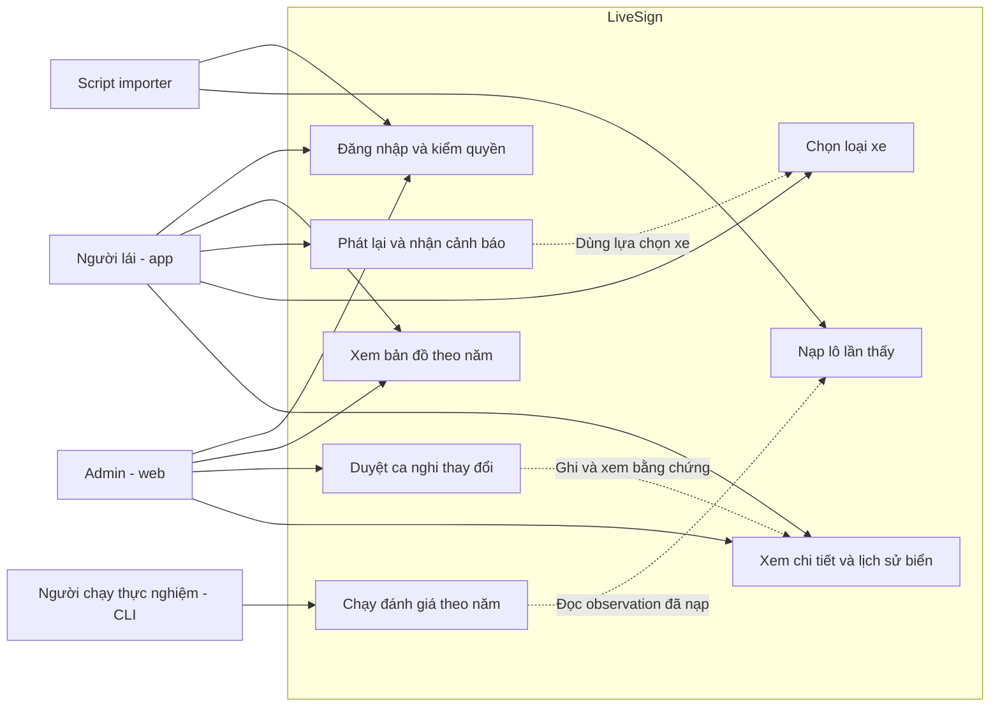

# Phân tích yêu cầu LiveSign

Mục tiêu: từ ảnh đường phố công khai, dựng bản đồ tấm biển có bằng chứng theo
thời gian; nhắc biển theo loại xe khi phát lại chuyến đi; đưa ca mâu thuẫn cho
admin. Tài liệu là thiết kế, không phải báo cáo chức năng đã chạy; luồng theo
[kiến trúc 1.2](architecture.md). Phần phải làm xong nằm ở [Phạm vi MVP](#phạm-vi-mvp).
Nguồn đúng là [quyết định repo](decisions.md), [hợp đồng API](contracts/api.md),
[tham số](../config/params.yaml); khác PDF cũ đã ghi trong decisions.md.

## Tác nhân và use case

| Tác nhân | Mục tiêu / quyền |
| --- | --- |
| Người lái (app, role user) | Xem bản đồ, chọn xe/chuyến/năm, phát lại, nghe nhắc và xem chi tiết/lịch sử được phép |
| Admin (web, role admin) | Xem bản đồ/hàng chờ/bằng chứng, quyết định thủ công có history; chỉ admin gỡ/thay |
| Script nạp (role importer) | Chuẩn bị dữ liệu công khai, nhập lô cùng schema/lớp và truy vết; không tự quyết gỡ/thay |
| Người chạy thực nghiệm (CLI trên máy, không qua API) | Chạy PB/B0–B3 theo năm trên observation chỉ đọc, chấm với bộ mốc; không ghi CSDL dịch vụ |

Mapillary/Vietmap là dịch vụ ngoài, không thay các tác nhân nghiệp vụ. Re-infer app
được phép gửi quan sát nhưng vẫn giữ creator/timestamp gốc, không tạo người mới.

### Xem bản đồ

| Mục | Đặc tả |
| --- | --- |
| Tác nhân | Người lái/admin |
| Tiền điều kiện | Phiên JWT đúng role, chọn evaluation_year hợp lệ và bbox WGS84 |
| Luồng chính | Lấy sign-types cùng version → gửi GET signs theo bbox/năm (đọc snapshot `ready`) → đọc hết cursor cần thiết → hiển thị marker/status và chú giải → mở chi tiết tấm |
| Luồng lỗi | 400 bbox/năm sai: yêu cầu sửa; 401 đăng nhập lại; 404 tấm chưa có ở cutoff; 503 `SNAPSHOT_NOT_READY`: báo đang dựng, thử lại sau; mất mạng chỉ hiển thị cache có nhãn/version |
| Hậu điều kiện | Chỉ trạng thái/vị trí của snapshot chọn được hiển thị; không cập nhật CSDL vì thao tác xem |
| Chấp nhận | Đổi năm không nhận response năm cũ; response bản đồ có `snapshot_run_id`; không lấy candidate/removed làm cảnh báo chỉ vì marker có trên bản đồ |

### Phát lại chuyến đi và nhận cảnh báo

| Mục | Đặc tả |
| --- | --- |
| Tác nhân | Người lái |
| Tiền điều kiện | Chuyến có trace timestamp giây/GPS, ảnh/manifest được đọc, loại xe/năm đã chọn; model hợp lệ nếu bật nhận diện |
| Luồng chính | GET trips/trace → GET biển dọc chuyến (một lần) → Map Matching cả vết (một lần) → phát theo t gốc, tải trước ảnh đúng image_id → lọc biển phía trước cục bộ theo vị trí/hướng/speed/xe → chống lặp → banner + TTS, ghi log thời gian |
| Luồng lỗi | Trace chỉ ngày/GPS nhảy: ngắt đoạn, không bịa tốc độ; thiếu ảnh: dừng/bỏ frame có log; thiếu map match: unverified; model sai lớp/hash: tắt suy luận và báo lỗi; 503 snapshot chưa sẵn sàng: chưa cho phát; >500 biển: 413, chia chuyến; mất mạng: chỉ cache phù hợp |
| Hậu điều kiện | Thể hiện đúng nhãn unclear/suspected_change; ảnh và bbox đồng bộ; replay thuần không sinh cặp bằng chứng mới |
| Chấp nhận | Nhắc trước ≥warning_min_lead_s=5 là chỉ tiêu đo; nếu trễ phải báo trễ, không sửa log. Không nhắc biển `alertable=false` (candidate/removed/replaced, thiếu hướng mặt, chỉ single_view, không áp dụng xe). Lọc cục bộ dùng `alert_params` từ response, ra cùng danh sách với `/signs/ahead` trên cùng trace |

### Chọn loại xe

| Mục | Đặc tả |
| --- | --- |
| Tác nhân | Người lái |
| Tiền điều kiện | Có danh mục lớp đúng version, chưa bắt đầu hoặc đang pause replay |
| Luồng chính | Chọn car/truck/motorcycle → lưu lựa chọn cục bộ → gọi lại `GET /trips/{trip_id}/signs` với `vehicle_type` mới → thay danh sách lọc của bộ nhắc |
| Luồng lỗi | Enum ngoài ba loại: chặn tại UI và server 400/422; response xe cũ đến muộn: bỏ; không có API ghi profile: không báo đã đồng bộ server |
| Hậu điều kiện | Chỉ nhắc lớp áp dụng loại xe theo sign_type; motorcycle trong demo là xe máy hai bánh |
| Chấp nhận | P.103a nhắc car/truck, không nhắc motorcycle; P.131a áp dụng cả ba; không suy lớp tốc độ/cấm riêng xe tải chưa có |

### Nạp lô lần thấy

| Mục | Đặc tả |
| --- | --- |
| Tác nhân | Importer, hoặc app re-infer có quyền user |
| Tiền điều kiện | JSONL/schema 1.0 đúng hợp đồng; một trip/lô; classes_version được hỗ trợ, creator/time giữ gốc; không có credential trong payload |
| Luồng chính | Chuẩn bị ảnh/metadata/manifest ngoài git → tạo observation ID bền → **lượt 1**: POST observations/batch chỉ seen/unknown, kèm bbox, tư thế camera, `feature_candidates` → kiểm envelope/dòng → lưu dòng hợp lệ/idempotency → job snapshot gọi `core` (gom, định vị, hướng mặt, gộp, điểm, trạng thái) cho các năm bị ảnh hưởng → trả count/kết quả dòng. **Lượt 2**, chỉ khi `negative_evidence_enabled`: GET signs theo năm chụp → kiểm nhìn được → POST not_seen → dựng lại run các năm bị ảnh hưởng |
| Luồng lỗi | Envelope sai: từ chối cả lô; từng dòng sai: rejected, dòng đúng vẫn lưu; cùng ID khác payload: conflict; not_seen khi chưa duyệt âm:422; retry cùng payload không nhân quan sát; model bỏ sót đơn thuần không được gửi âm |
| Hậu điều kiện | Truy vết được ảnh/model/creator/time; unknown không cộng điểm/độ mới; N/θ null chưa tự xác nhận; run snapshot mới `ready`, run cũ phục vụ tới lúc đó rồi sang `superseded` |
| Chấp nhận | Count tổng bằng số dòng, duplicate không tăng cặp; source/trip/sequence/creator bất biến đúng envelope |

### Duyệt ca nghi thay đổi

| Mục | Đặc tả |
| --- | --- |
| Tác nhân | Admin |
| Tiền điều kiện | JWT admin, ca pending thuộc snapshot, ảnh trước/sau đủ đọc và version còn khớp |
| Luồng chính | GET queue/detail/evidence → xem điểm/tuổi/lý do → chọn confirm/keep/remove/replace/defer + lý do → POST decision expected_version → transaction sign/review/history → dựng lại run các năm mà quyết định có hiệu lực → nhận trạng thái mới |
| Luồng lỗi | 403: không có quyền; thiếu bằng chứng/replacement:422; 409: tải và xem lại trước quyết; mất mạng sau gửi: đọc lại version trước thử lại; không tự retry thao tác gỡ/thay |
| Hậu điều kiện | confirm/keep là manual; defer còn pending; removed/replaced chỉ admin và giữ history; tấm thay có sign_id riêng |
| Chấp nhận | Hai admin cùng version chỉ một quyết định được ghi; không gỡ chỉ vì thiếu ảnh mới; một ca pending/sign |

Mở ca xác nhận thủ công cho candidate/unclear (`POST /admin/reviews`, API 1.1) **không
thuộc MVP**, nằm ở mục Nên có; không giả chúng đã nghi thay đổi để dùng hàng chờ hiện có.

### Xem lịch sử biển

| Mục | Đặc tả |
| --- | --- |
| Tác nhân | Người lái/admin |
| Tiền điều kiện | Sign tồn tại trong năm đã chọn; quyền đọc phù hợp |
| Luồng chính | GET sign detail → GET sign history theo năm/cursor → hiển thị trạng thái/loại trước và sau, effective/recorded time, lý do; admin có thể xem evidence được phép |
| Luồng lỗi | 404 trước khi tấm xuất hiện: thông báo đúng năm; rỗng: chưa có lịch sử phục vụ; mất mạng/cache: nhãn dữ liệu đã lưu; user gọi ảnh admin:403 |
| Hậu điều kiện | Không lộ mật khẩu/token/ghi chú nội bộ cho user; không dùng history tương lai đổi snapshot cũ |
| Chấp nhận | removed/replaced vẫn xem được lịch sử; không xóa vật lý tấm để biến mất lịch sử |

### Chạy đánh giá theo năm

| Mục | Đặc tả |
| --- | --- |
| Tác nhân | Người chạy thực nghiệm |
| Tiền điều kiện | Corpus/manifest, bộ mốc tuyến demo và cấu hình (params_version, hash) đã khóa; observation đã nạp; tập chọn tham số tách khỏi năm được chấm |
| Luồng chính | CLI (cùng jar `core`) đọc observation trước cutoff, JDBC chỉ đọc → chạy PB, B0–B3 cho 2023/2024/2025, pre/post review → xuất `maps-<năm>-<bậc>-<pre\|post>.csv` + manifest → script Python ghép một–một với bộ mốc → map-metrics, matches, conflict-cases ([evaluation.md](evaluation.md)) |
| Luồng lỗi | N/θ null hoặc B3 không được giữ: bậc phụ thuộc ghi not_run; thiếu snapshot feature Mapillary tại T: not_available; mẫu số 0: null, không tự 0%/100% |
| Hậu điều kiện | Không ghi CSDL dịch vụ; mỗi CSV có manifest đủ tái lập |
| Chấp nhận | Cùng đầu vào ra cùng hash file; không dùng observation/quyết định sau cutoff; không lấy bảng `sign_snapshot` làm kết quả thực nghiệm |

## Yêu cầu phi chức năng và nghiệm thu

| Yêu cầu | Số / trạng thái | Bằng chứng kiểm tra |
| --- | --- | --- |
| Phạm vi | Lõi Hoàn Kiếm khoảng 1,5 km, 12 lớp đã duyệt; tuyến cụ thể candidate | Tuyến/hash và manifest đã nhóm chốt; không tự đổi sang Trần Phú của PoC |
| Năm đánh giá | 2023,2024,2025; cutoff độc quyền năm sau | Ca dữ liệu sau cutoff không đổi score/vị trí/history năm trước |
| Nhắc kịp | ≥5 s, đã chốt trong params | Log t_gặp/t_banner/t_TTS trên máy thật; báo tỷ lệ đạt và trễ |
| FPS / độ trễ | Cần đo/chốt; không có ngưỡng repo đã duyệt | FPS inference/hiển thị, latency p50/p95 trên cùng clip 1x, ít nhất 3 lượt dự kiến |
| Pin | Cần đo; cửa sổ 10 phút dự kiến | Pin/nhiệt, máy không sạc, điều kiện mạng/màn hình và lặp phép đo |
| Không tạo âm sai | ≤30 m + đủ góc/hướng/nét/không che, âm đã duyệt | Ca 30/30,01 m, cờ null/false, focal thiếu và B3 chưa bật |
| Nhất quán | Một danh mục, một cấu hình có version/hash | classes.yaml/dataset/labels/sign_type/API cùng mã/thứ tự |
| Dữ liệu không gian | WGS84 [lon,lat], POINT SRID 4326, mét, hướng độ | MySQL SPATIAL và round-trip lon/lat; không so độ với 20 m |
| Nạp lô | Tối đa 500 dòng, 60 request/phút là đề xuất 1.0 | Thử 413/429/idempotency/partial results, chốt tải sau đo |
| Auth/bảo mật | bcrypt cho mật khẩu, JWT Bearer, role user/importer/admin, HTTPS | Không ghi plain password/token; user không gọi quyết định; kiểm path/ảnh/cutoff |
| Truy vết | 100% dòng được tính điểm có ảnh/creator/time/model và target liên kết hợp lệ | Thiếu không vào cặp, metadata_only lưu audit riêng |
| Tái lập | Corpus/GT/model/config/registry/commit/hash bất biến | Cùng manifest cho cùng kết quả, kể cả thứ tự lô hoặc công bố giới hạn registry |
| Snapshot | Dựng sau mỗi lô/quyết định admin; API chỉ đọc run `ready` mới nhất, không tính lại khi đọc | Test đọc trong lúc dựng vẫn ra run cũ; 503 khi năm chưa có run |
| Một bản thuật toán | Định vị/hướng mặt/gộp/điểm/vòng đời chỉ trong `core` | Không có bản thứ hai trong Python/Kotlin; lọc cục bộ app khớp `/signs/ahead` trên cùng trace |

D=v×(5 s+đệm) chỉ bù độ trễ trung bình, chưa bảo đảm mọi lượt nhắc kịp; hạn chế đã nêu trong thuật toán.
Không thêm ngưỡng FPS, pin hoặc độ chính xác 2–3 m như số đã đo. Ngưỡng
FPS/latency/pin không chặn MVP: MVP phải đo và báo đủ theo protocol evaluation.md,
ngưỡng đạt đặt sau pilot (xem Phụ thuộc chưa có số).

## Phạm vi MVP

Chốt 19/10. MVP là bản phải xong để bảo vệ: **một luồng demo trọn** từ ảnh Mapillary
đến nhắc biển và admin duyệt, cộng **đủ số liệu trả lời câu hỏi nghiên cứu** (PB, B0–B3
theo năm). Mục Nên có chỉ bắt đầu khi tiêu chí hoàn thành bên dưới đã đạt.

### Bắt buộc

| Phần | Phải có | Use case / nguồn |
| --- | --- | --- |
| Dữ liệu | Corpus Mapillary của **một** tuyến demo ~1,5 km, ba năm 2023–2025, manifest có hash; bộ mốc tuyến đó theo [ground-truth.md](contracts/ground-truth.md), ≥20% tấm gán chéo | Chạy đánh giá |
| AI | YOLOv8n 12 lớp từ dataset công khai, test Hà Nội độc lập; batch toàn ảnh xuất JSONL lượt 1 (seen/unknown, bbox, tư thế camera, `feature_candidates`); gói TFLite + manifest; bài thử B3 | [ai-pipeline.md](ai-pipeline.md), [model.md](contracts/model.md) |
| Backend + `core` | Login JWT ba role, sign-types; nhập lô; `core`: định vị (giao tia → feature → camera_proxy), hướng mặt, gộp, điểm Beta giảm dần, đủ vòng đời; job snapshot; API bbox, chi tiết/history, trips/trace/ảnh, biển dọc chuyến, `/signs/ahead` (tham chiếu), hàng chờ/chi tiết ca/quyết định | Nạp lô, Xem bản đồ, Xem lịch sử, Duyệt ca |
| Lượt not_seen | Đủ đường code lượt 2 + kiểm nhìn được. Bật trên dữ liệu thật chỉ khi B3 được giữ; môi trường mô phỏng (CSDL riêng, `scenario_id`, bản params riêng bật `negative_evidence_enabled`) luôn dùng được | [algorithms.md](algorithms.md) |
| App Android | Đăng nhập; bản đồ Vietmap theo năm; chọn chuyến/năm/xe (xe lưu cục bộ); phát lại trace + ảnh; Map Matching cả vết; lọc cục bộ, banner + TTS, log thời gian; TFLite chạy trên ảnh phát lại để vẽ bbox và đo FPS, **không** gửi observation | Phát lại, Chọn xe, Xem bản đồ |
| Web admin | Đăng nhập; bản đồ có lọc; hàng chờ; duyệt ca có ảnh trước/sau với confirm/keep/remove/replace/defer; chi tiết + history | Duyệt ca, Xem lịch sử |
| Thực nghiệm | CLI chạy PB, B0, B1, B2 (B3 nếu giữ; khoảng giữa thì là phân tích phụ) × 3 năm × pre/post; script chấm; mô phỏng 10 biển giả + thay 5 biển; ca thật báo riêng; đánh giá model; đo Android thật theo protocol | Chạy đánh giá, [evaluation.md](evaluation.md) |

Cả ba dấu hiệu mâu thuẫn (a)(b)(c) đều cần not_seen hợp lệ. Nếu B3 bị bỏ, dữ liệu thật
sẽ không sinh ca NGHI THAY ĐỔI; demo hàng chờ và chỉ số mâu thuẫn khi đó chỉ chạy bằng
CSDL mô phỏng có nhãn ([ui.md](ui.md), Khung cảnh demo). MVP vẫn đạt trong trường hợp này.

### Nên có — sau khi MVP đạt

- Re-infer trên app gửi `POST /observations/batch` (trip phiên riêng, giữ creator/time gốc).
- `POST /admin/reviews` mở ca xác nhận thủ công cho candidate/unclear (API 1.1).
- `POST /admin/signs` cho admin tạo tấm biển chưa có trong dữ liệu (API 1.0).
- Tải trước cả chuyến/cache có nhãn version để phát lại khi mất mạng giữa chừng.
- MinIO thay ổ đĩa cho kho ảnh và manifest.

### Không làm

Redis, DETR/RT-DETR, FastAPI; chỉ đường; biển phụ, làn, phạm vi hiệu lực, lớp tốc độ;
API ghi hồ sơ xe; tự thu ảnh ngoài đường; thống kê người dùng; phát hành model tự động;
xóa vật lý sign/history; tuyến thứ hai.

### Phụ thuộc chưa có số — không đổi phạm vi

| Mục | MVP xử lý thế nào | Hạn |
| --- | --- | --- |
| Tuyến demo | Làm trên đúng một tuyến; chưa chốt thì chưa đóng corpus/bộ mốc, không thay bằng tuyến PoC Trần Phú | 25/10 |
| N/θ/θ_thấp | Phải có `value` trước lần dựng snapshot thật: số đo nếu đủ, không thì nhóm ghi giá trị quy ước (đề xuất 3/0,75/0,40) và báo độ nhạy. Còn null thì không biển nào tự xác nhận, app không có biển để nhắc | 25/10 |
| B3 | ≥50% giữ, <30% bỏ (params). Khoảng [30%,50%): không bật âm cho bản đồ sản phẩm; B3 chỉ chạy trong CLI như phân tích phụ, báo kèm tỷ lệ bài thử | 25/10 |
| FPS/latency/pin | Không chặn MVP: đo đủ protocol và báo số; ngưỡng đạt đặt sau pilot | Sau pilot |
| Quyết định admin trong post_review | Quyết định làm năm 2026 không qua kiểm decided_at của 2023–2025; cách gán mốc hồi cứu theo bảng Còn mở của decisions.md. MVP vẫn phải ra đủ cột pre/post | Trước chạy post_review |

### Tiêu chí MVP hoàn thành

1. Nạp corpus tuyến demo ba năm từ một manifest → mỗi năm 2023/2024/2025 có `snapshot_run` `ready`.
2. App phát lại ít nhất một chuyến mỗi năm, nhắc đúng loại xe (P.103a không nhắc motorcycle), có log t_gặp/t_banner/t_TTS.
3. Test đối chiếu: lọc cục bộ của app và `/signs/ahead` ra cùng danh sách trên cùng trace.
4. Khung cảnh demo chạy trọn: biển xác nhận 2023 → NGHI THAY ĐỔI → admin replace → app nhắc biển mới; bản đồ 2023 không đổi. Chạy trong môi trường mô phỏng (quyết định thật làm năm 2026 không vào bản đồ 2023–2025); ảnh có thể là ca thật. Biển thay phải tự đạt confirmed_auto bằng bằng chứng có sẵn (kịch bản mô phỏng cấp đủ N cặp), để demo không phụ thuộc mục Nên có.
5. CLI + script ra `map-metrics.csv` đủ tổ hợp bậc × năm × pre/post, hoặc lý do not_run; cùng đầu vào cùng hash.
6. Có `model-metrics.csv` và `device-runs.csv` (≥3 lượt) trên máy Android thật.
7. Các test ở mục "Unit test điểm và vòng đời — bắt buộc" và "Bổ sung theo kiến trúc 1.2" của [testing.md](testing.md) chạy đạt.

## Ngoài phạm vi và giới hạn

Không tự thu ảnh ngoài đường, không chỉ đường, không đọc biển phụ/làn/phạm vi hiệu
lực, không chứng minh cảnh báo quá tốc độ với danh mục hiện không có lớp tốc độ.
Không dựng Redis/RT-DETR/FastAPI cho luồng lõi. Đánh giá là dữ liệu lịch sử công
khai phát lại; score quy ước chưa là xác suất, người chụp khác tài khoản chỉ đại
diện gần đúng độc lập. Các ca tiêm giả không thay cho bằng chứng ngoài đường thật.
