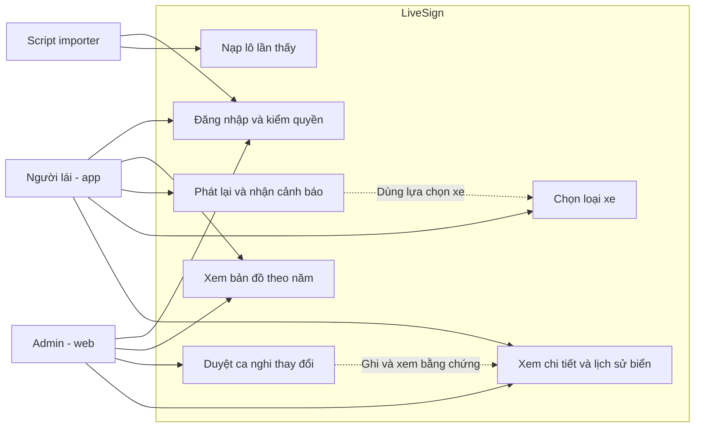

# Phân tích yêu cầu LiveSign

Mục tiêu: từ ảnh đường phố công khai, dựng bản đồ tấm biển có bằng chứng theo
thời gian; nhắc biển theo loại xe khi phát lại chuyến đi; đưa ca mâu thuẫn cho
admin. Tài liệu là thiết kế, không phải báo cáo chức năng đã chạy.
Nguồn đúng là [quyết định repo](decisions.md), [hợp đồng API](contracts/api.md),
[tham số](../config/params.yaml); khác PDF cũ đã ghi trong decisions.md.

## Tác nhân và use case

| Tác nhân | Mục tiêu / quyền |
| --- | --- |
| Người lái (app, role user) | Xem bản đồ, chọn xe/chuyến/năm, phát lại, nghe nhắc và xem chi tiết/lịch sử được phép |
| Admin (web, role admin) | Xem bản đồ/hàng chờ/bằng chứng, quyết định thủ công có history; chỉ admin gỡ/thay |
| Script nạp (role importer) | Chuẩn bị dữ liệu công khai, nhập lô cùng schema/lớp và truy vết; không tự quyết gỡ/thay |

Mapillary/Vietmap là dịch vụ ngoài, không thay ba tác nhân nghiệp vụ. Re-infer app
được phép gửi quan sát nhưng vẫn giữ creator/timestamp gốc, không tạo người mới.

### Xem bản đồ

| Mục | Đặc tả |
| --- | --- |
| Tác nhân | Người lái/admin |
| Tiền điều kiện | Phiên JWT đúng role, chọn evaluation_year hợp lệ và bbox WGS84 |
| Luồng chính | Lấy sign-types cùng version → gửi GET signs theo bbox/năm → đọc hết cursor cần thiết → hiển thị marker/status và chú giải → mở chi tiết tấm |
| Luồng lỗi | 400 bbox/năm sai: yêu cầu sửa; 401 đăng nhập lại; 404 tấm chưa có ở cutoff; mất mạng chỉ hiển thị cache có nhãn/version |
| Hậu điều kiện | Chỉ trạng thái/vị trí của snapshot chọn được hiển thị; không cập nhật CSDL vì thao tác xem |
| Chấp nhận | Đổi năm không nhận response năm cũ; không lấy candidate/removed làm cảnh báo chỉ vì marker có trên bản đồ |

### Phát lại chuyến đi và nhận cảnh báo

| Mục | Đặc tả |
| --- | --- |
| Tác nhân | Người lái |
| Tiền điều kiện | Chuyến có trace timestamp giây/GPS, ảnh/manifest được đọc, loại xe/năm đã chọn; model hợp lệ nếu bật nhận diện |
| Luồng chính | GET trips/trace → phát theo t gốc → lấy ảnh đúng image_id → Map Matching → GET signs/ahead với vị trí/hướng/speed/xe/năm → lọc chống lặp → banner + TTS, ghi log thời gian |
| Luồng lỗi | Trace chỉ ngày/GPS nhảy: ngắt đoạn, không bịa tốc độ; thiếu ảnh: dừng/bỏ frame có log; thiếu map match: unverified; model sai lớp/hash: tắt suy luận và báo lỗi; mất mạng: chỉ cache phù hợp |
| Hậu điều kiện | Thể hiện đúng nhãn unclear/suspected_change; ảnh và bbox đồng bộ; replay thuần không sinh cặp bằng chứng mới |
| Chấp nhận | Nhắc trước ≥warning_min_lead_s=5 là chỉ tiêu đo; nếu trễ phải báo trễ, không sửa log. Không nhắc candidate/removed/replaced |

### Chọn loại xe

| Mục | Đặc tả |
| --- | --- |
| Tác nhân | Người lái |
| Tiền điều kiện | Có danh mục lớp đúng version, chưa bắt đầu hoặc đang pause replay |
| Luồng chính | Chọn car/truck/motorcycle → lưu lựa chọn phiên/cục bộ → request ahead tiếp theo mang loại mới → cập nhật bộ nhắc |
| Luồng lỗi | Enum ngoài ba loại: chặn tại UI và server 400/422; response xe cũ đến muộn: bỏ; không có API ghi profile: không báo đã đồng bộ server |
| Hậu điều kiện | Chỉ nhắc lớp áp dụng loại xe theo sign_type; motorcycle trong demo là xe máy hai bánh |
| Chấp nhận | P.103a nhắc car/truck, không nhắc motorcycle; P.131a áp dụng cả ba; không suy lớp tốc độ/cấm riêng xe tải chưa có |

### Nạp lô lần thấy

| Mục | Đặc tả |
| --- | --- |
| Tác nhân | Importer, hoặc app re-infer có quyền user |
| Tiền điều kiện | JSONL/schema 1.0 đúng hợp đồng; một trip/lô; classes_version được hỗ trợ, creator/time giữ gốc; không có credential trong payload |
| Luồng chính | Chuẩn bị ảnh/metadata/manifest ngoài git → tạo observation ID bền → POST observations/batch → kiểm envelope/dòng → lưu dòng hợp lệ/idempotency → gán tấm → tính lại sign liên quan → trả count/kết quả dòng |
| Luồng lỗi | Envelope sai: từ chối cả lô; từng dòng sai: rejected, dòng đúng vẫn lưu; cùng ID khác payload: conflict; not_seen khi chưa duyệt âm:422; retry cùng payload không nhân quan sát; model bỏ sót đơn thuần không được gửi âm |
| Hậu điều kiện | Truy vết được ảnh/model/creator/time; unknown không cộng điểm/độ mới; N/θ null chưa tự xác nhận |
| Chấp nhận | Count tổng bằng số dòng, duplicate không tăng cặp; source/trip/sequence/creator bất biến đúng envelope |

### Duyệt ca nghi thay đổi

| Mục | Đặc tả |
| --- | --- |
| Tác nhân | Admin |
| Tiền điều kiện | JWT admin, ca pending thuộc snapshot, ảnh trước/sau đủ đọc và version còn khớp |
| Luồng chính | GET queue/detail/evidence → xem điểm/tuổi/lý do → chọn confirm/keep/remove/replace/defer + lý do → POST decision expected_version → transaction sign/review/history → nhận trạng thái mới |
| Luồng lỗi | 403: không có quyền; thiếu bằng chứng/replacement:422; 409: tải và xem lại trước quyết; mất mạng sau gửi: đọc lại version trước thử lại; không tự retry thao tác gỡ/thay |
| Hậu điều kiện | confirm/keep là manual; defer còn pending; removed/replaced chỉ admin và giữ history; tấm thay có sign_id riêng |
| Chấp nhận | Hai admin cùng version chỉ một quyết định được ghi; không gỡ chỉ vì thiếu ảnh mới; một ca pending/sign |

Mở ca xác nhận thủ công cho candidate/unclear là bổ sung 1.1 cần nhóm duyệt;
không giả chúng đã nghi thay đổi để dùng hàng chờ hiện có.

### Xem lịch sử biển

| Mục | Đặc tả |
| --- | --- |
| Tác nhân | Người lái/admin |
| Tiền điều kiện | Sign tồn tại trong năm đã chọn; quyền đọc phù hợp |
| Luồng chính | GET sign detail → GET sign history theo năm/cursor → hiển thị trạng thái/loại trước và sau, effective/recorded time, lý do; admin có thể xem evidence được phép |
| Luồng lỗi | 404 trước khi tấm xuất hiện: thông báo đúng năm; rỗng: chưa có lịch sử phục vụ; mất mạng/cache: nhãn dữ liệu đã lưu; user gọi ảnh admin:403 |
| Hậu điều kiện | Không lộ mật khẩu/token/ghi chú nội bộ cho user; không dùng history tương lai đổi snapshot cũ |
| Chấp nhận | removed/replaced vẫn xem được lịch sử; không xóa vật lý tấm để biến mất lịch sử |

## Yêu cầu phi chức năng và nghiệm thu

| Yêu cầu | Số / trạng thái | Bằng chứng kiểm tra |
| --- | --- | --- |
| Phạm vi | Lõi Hoàn Kiếm khoảng 1,5 km, 12 lớp đã duyệt; tuyến cụ thể candidate | Tuyến/hash và manifest đã nhóm chốt; không tự đổi sang Trần Phú của PoC |
| Năm đánh giá | 2023,2024,2025; cutoff độc quyền năm sau | Ca dữ liệu sau cutoff không đổi score/vị trí/history năm trước |
| Nhắc kịp | ≥5 s, đã chốt trong params | Log t_gặp/t_banner/t_TTS trên máy thật; báo tỷ lệ đạt và trễ |
| FPS / độ trễ | Cần đo/chốt; không có ngưỡng repo đã duyệt | FPS inference/hiển thị, latency p50/p95 trên cùng clip 1x, ít nhất 3 lượt dự kiến |
| Pin | Cần đo; cửa sổ 10 phút dự kiến | Pin/nhiệt, máy không sạc, điều kiện mạng/màn hình và lặp phép đo |
| Không tạo âm sai | ≤30 m + đủ góc/hướng/nét/không che, âm đã duyệt | Ca 30/30,01 m, cờ null/false, focal thiếu và B3 chưa bật |
| Nhất quán | Một danh mục, một cấu hình có version/hash | classes.yaml/dataset/labels/sign_type/API cùng mã/thứ tự |
| Dữ liệu không gian | WGS84 [lon,lat], POINT SRID 4326, mét, hướng độ | MySQL SPATIAL và round-trip lon/lat; không so độ với 20 m |
| Nạp lô | Tối đa 500 dòng, 60 request/phút là đề xuất 1.0 | Thử 413/429/idempotency/partial results, chốt tải sau đo |
| Auth/bảo mật | bcrypt cho mật khẩu, JWT Bearer, role user/importer/admin, HTTPS | Không ghi plain password/token; user không gọi quyết định; kiểm path/ảnh/cutoff |
| Truy vết | 100% dòng được tính điểm có ảnh/creator/time/model và target liên kết hợp lệ | Thiếu không vào cặp, metadata_only lưu audit riêng |
| Tái lập | Corpus/GT/model/config/registry/commit/hash bất biến | Cùng manifest cho cùng kết quả, kể cả thứ tự lô hoặc công bố giới hạn registry |

D=v×(5 s+đệm) chỉ bù độ trễ trung bình, chưa bảo đảm mọi lượt nhắc kịp; hạn chế đã nêu trong thuật toán.
Không thêm ngưỡng FPS, pin hoặc độ chính xác 2–3 m như số đã đo.
**Cần nhóm quyết:** khóa chỉ tiêu FPS/latency/pin và tuyến cụ thể sau pilot; đề xuất
dùng protocol evaluation.md trước khi đặt ngưỡng để có căn cứ máy thật. Các mục
này đã nằm trong bảng Còn mở, không yêu cầu người viết tài liệu tự quyết.

## Ngoài phạm vi và giới hạn

Không tự thu ảnh ngoài đường, không chỉ đường, không đọc biển phụ/làn/phạm vi hiệu
lực, không chứng minh cảnh báo quá tốc độ với danh mục hiện không có lớp tốc độ.
Không dựng Redis/RT-DETR/FastAPI cho luồng lõi. Đánh giá là dữ liệu lịch sử công
khai phát lại; score quy ước chưa là xác suất, người chụp khác tài khoản chỉ đại
diện gần đúng độc lập. Các ca tiêm giả không thay cho bằng chứng ngoài đường thật.
