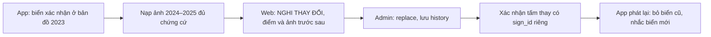

# Giao diện và luồng thao tác

Thiết kế wireframe, **chưa có màn hình app/web chạy**. Base API `/api/v1` theo
[hợp đồng](contracts/api.md). Mọi màn có nhãn năm snapshot; không gọi trạng thái
cuối năm là hiện trạng đúng tại từng giây ảnh replay. Chỉ hiển thị số thật từ response.

## Quy tắc chung

| Dữ liệu / tình huống | Cách hiển thị |
| --- | --- |
| candidate | Ứng viên; trên bản đồ, không nhắc TTS |
| confirmed_auto / confirmed_manual | Phân biệt “tự động” / “thủ công”; không trộn tỷ lệ thống kê |
| unclear | “Lâu chưa xác minh”; vẫn có thể nhắc kèm nhãn |
| suspected_change | “Chưa chắc chắn”; vẫn nhắc có nhãn, dẫn tới ca duyệt trên web |
| removed / replaced | Không nhắc biển cũ; web giữ lịch sử, biển thay là sign_id khác |
| Điểm | Đồng thuận, tuổi dương, tuổi bằng chứng và mâu thuẫn riêng; không ghi “xác suất đúng” |
| Đang tải | Skeleton/spinner ở vùng đang tải, giữ lựa chọn năm/xe; không dựng số 0 giả |
| Mất mạng | Banner, timestamp/hash cache; không báo đã gửi observation hoặc quyết định thành công |
| Lỗi 401/403 | Đăng nhập lại / không có quyền; không giữ nút admin hoạt động ở role user |
| Đổi năm/chuyến | Hủy request/ảnh cũ, tăng generation phiên và reset chống nhắc có log |

## App — bản đồ chính

Mục đích: xem biển trên bbox và vào replay/chi tiết; không làm chỉ đường.

```text
+--------------------------------------+
| LiveSign        Năm: 2025   [Cài đặt] |
| [Chọn chuyến]    Xe: car              |
|--------------------------------------|
|                                      |
|             BẢN ĐỒ VIETMAP            |
|    o xác nhận       ? chưa chắc       |
|                                      |
|--------------------------------------|
| Chú giải: tự động / thủ công / cũ      |
| [Phát lại chuyến đã chọn]             |
+--------------------------------------+
```

Dữ liệu: sign_id, mã/loại, vị trí, hướng mặt, status, year/version.
Gọi GET `/sign-types`, GET `/signs?bbox=...&evaluation_year=...` khi bbox đổi ổn định.
Hành động: pan/zoom, chạm marker → chi tiết; chọn chuyến; mở cài đặt.

| Trạng thái | Xử lý màn |
| --- | --- |
| Tải / rỗng | Hiện tải lớp biển / “Chưa có biển trong vùng ở năm này”; không kết luận đường không có biển |
| Lỗi / mất mạng | Nút thử lại, bản đồ cache nếu có quyền; banner “dữ liệu đã lưu”, không gắn nhãn mới xác minh |

## App — chọn chuyến, năm và xe

Mục đích: tạo bối cảnh replay nhất quán trước khi phát.

```text
+--------------------------------------+
| Chọn phát lại                         |
| Năm bản đồ: [2023] [2024] [2025*]      |
| Loại xe:    [car*] [truck] [motorcycle]|
| Chuyến                               |
|  ( ) sequence ...  ngày ...  ... điểm |
|  ( ) Minh họa, không có ảnh thực       |
| [Xem manifest]          [Bắt đầu]      |
+--------------------------------------+
```

Gọi GET `/trips?evaluation_year=...`, GET trace Accept JSON để kiểm manifest rồi
tải NDJSON. Xe được lưu **cục bộ lựa chọn phiên**, gửi vào `/signs/ahead`; chưa có
API ghi vehicle_profile thì không hiện “đã đồng bộ hồ sơ xe lên server”.
Không dùng biển chọn trên bản đồ làm vị trí xe.

| Trạng thái | Hành động / xử lý |
| --- | --- |
| Đang tải | Khóa nút bắt đầu tới khi có trip/manifest hợp lệ |
| Rỗng | “Chưa có chuyến phát được ở năm này”; đổi năm hoặc trở về bản đồ |
| Lỗi 422 | “Trace thiếu thời gian/vị trí để phát”; không tự tạo FPS/GPS |
| Mất mạng | Chỉ chọn chuyến cache cùng year/hash; không giả đã tải file |

## App — phát lại và cảnh báo

```text
+--------------------------------------+
| Chuyến ...     Bản đồ hết 2025   car   |
|--------------------------------------|
|              BẢN ĐỒ                  |
|              ^ xe                    |
|--------------------------------------|
| ẢNH image_id ...   t: UTC ...         |
| [bbox detector trên đúng ảnh]         |
|--------------------------------------|
| P.131a - Cấm đỗ xe   45 m             |
| Chưa chắc chắn / lâu chưa xác minh    |
| [Tắt tiếng]                           |
| [Lùi] [Tạm dừng] ----o---- [1x]        |
+--------------------------------------+
```

Dữ liệu: điểm trace gốc, ảnh hiện tại, detection TFLite nếu bật, tọa độ đã map
match riêng, items ahead. Gọi GET ảnh theo trip/image/year và GET `/signs/ahead`
với lon/lat/hướng/speed/xe/năm/road_ref; JWT đúng quyền. Detector không trực tiếp
quyết sign.status. Replay thuần không gửi lại bằng chứng đã nhập.

| Trạng thái | Hành động / xử lý |
| --- | --- |
| Tải ảnh/API | Có chỉ báo riêng; giữ/đợi đúng frame, không vẽ bbox ảnh cũ lên frame mới |
| Không có cảnh báo | Hiện “Không có biển đủ điều kiện nhắc tại điểm này”, vẫn phát ảnh |
| Ảnh thiếu / GPS nhảy | Placeholder hoặc dừng ở segment; ghi frame bỏ/không đủ hướng |
| Mất mạng | Báo cache snapshot/ảnh đang dùng; không nói dữ liệu cũ là mới xác minh |

TTS nói mã/tên ngắn và nhãn chưa chắc khi có, không đọc confidence thành tỷ lệ
an toàn. Chống lặp theo phiên/sign, không theo loại. Pause/seek/đổi xe có xử lý
generation; tăng tốc trình diễn không đổi speed_mps gốc. Với mẫu illustration,
có placeholder rõ và không phát thông báo như đang lái ngoài đường.

## App — chi tiết biển

```text
+--------------------------------------+
| P.131a - Cấm đỗ xe          [Đóng]     |
| Trạng thái: Xác nhận thủ công         |
| Năm: 2025     Hướng mặt: 180 độ        |
| Đồng thuận: ...   Cặp dương / âm: ...  |
| Tuổi thấy / mọi bằng chứng: ...        |
| Mâu thuẫn: ...                        |
| [Lịch sử]                             |
+--------------------------------------+
```

Gọi GET `/signs/{sign_id}?evaluation_year=...` và GET history. Dữ liệu không có
hướng/điểm thì hiện “chưa có”, không 0°. Không gọi endpoint ảnh admin từ app user;
chi tiết user chỉ hiển thị metadata/lịch sử được phép.
Tải: skeleton từng vùng; rỗng/404: biển không thuộc snapshot, quay lại bản đồ;
lỗi: thử lại; mất mạng: ghi rõ chi tiết cache cùng version. Hành động xem lịch sử,
đóng, không có nút gỡ/thay hoặc sửa tọa độ cho người lái.

## App — cài đặt và đăng nhập

```text
+--------------------------------------+
| Cài đặt                               |
| Tài khoản: chưa đăng nhập             |
| Username [.........................]  |
| Password [.........................]  |
| [Đăng nhập]                           |
| TTS [Bật]     Xe mặc định [car]        |
| Model: version ... / chưa có          |
| [Kiểm gói model]       [Đăng xuất]     |
+--------------------------------------+
```

POST `/auth/login`; token giữ bằng cơ chế bảo vệ của hệ điều hành, không log.
Lựa chọn xe/TTS cục bộ; model đọc từ gói đã bàn giao ngoài git, kiểm hash/lớp.
Tải: vô hiệu gửi lặp login; rỗng: chưa có phiên/model; sai mật khẩu: thông báo
không lộ tài khoản có tồn tại; mất mạng: giữ lựa chọn nhưng không giả đăng nhập.
Đăng xuất xóa phiên/khóa request có auth; không xóa ảnh nguồn hoặc tài khoản trên server.

## Web — đăng nhập

```text
+------------------------------------------------------+
| LiveSign - Quản trị                                   |
| Tên đăng nhập [....................................]  |
| Mật khẩu     [....................................]  |
| [Đăng nhập]                                          |
+------------------------------------------------------+
```

POST `/auth/login`, chỉ role admin mở chức năng quản trị. JWT theo hợp đồng Bearer,
giữ trong phiên ứng dụng, không ghi URL/log. Loading khóa submit; lỗi có retry;
role sai →403 màn không có quyền; chưa nhập → lỗi tại trường; mất mạng không gửi
lại mật khẩu tự động vô hạn. Đăng xuất kết thúc phiên phía client.

## Web — bản đồ biển có bộ lọc

```text
+----------------------------------------------------------------+
| LiveSign admin | Năm [2025] | [Hàng chờ] [Đăng xuất]              |
| Trạng thái [tất cả]  Loại [tất cả]                               |
|--------------------------------------------+-------------------|
|                                            | Tấm đang chọn     |
|             BẢN ĐỒ LEAFLET                  | mã / status       |
|                                            | điểm / tuổi / cặp |
|                                            | [Chi tiết]        |
+--------------------------------------------+-------------------+
```

GET `/sign-types`, `/signs?bbox=...&status=...&evaluation_year=...`.
Bộ lọc loại có thể lọc client trên items đã tải đủ hoặc duyệt cursor toàn bộ trước
khi báo số; không lấy số trang đầu làm tổng. Chưa có query loại server trong 1.0
thì không tự gọi endpoint giả. Marker có text/icon khác nhau, không chỉ màu.
Loading: overlay lớp dữ liệu; rỗng: ghi bộ lọc/năm; lỗi/mất mạng: giữ khung bản đồ,
khóa quyết định từ dữ liệu không còn mới, cho thử lại.

## Web — hàng chờ NGHI THAY ĐỔI

```text
+----------------------------------------------------------------+
| Hàng chờ - Năm 2025                   [Làm mới]                 |
| Biển       Trạng thái       Lý do             [Mở ca]           |
| P.123a     suspected_change K cặp cuối âm     [Xem]             |
| ...                                                            |
| [Trang tiếp theo]                                               |
+----------------------------------------------------------------+
```

GET `/admin/reviews?status=pending&sign_status=suspected_change&evaluation_year=...`.
Mỗi review_id một hàng; nhiều lý do cùng sign không nhân ca pending. Loading:
skeleton; rỗng: “Không có ca pending theo bộ lọc”, không kết luận mọi biển đúng;
lỗi/mất mạng: không tự bỏ hàng, nút làm mới. Hành động mở detail, phân trang giữ
cursor/năm, không có quyết định hàng loạt chưa xem bằng chứng.

## Web — duyệt một ca

```text
+----------------------------------------------------------------+
| Ca review_id ... | Biển P.123a | Năm 2025 | version ...          |
|-------------------------------+--------------------------------|
| ẢNH TRƯỚC                     | ẢNH SAU                        |
| image_id, captured_at         | image_id, captured_at          |
| outcome / kiểm nhìn được      | outcome / kiểm nhìn được       |
|-------------------------------+--------------------------------|
| Điểm theo năm | tuổi dương / bằng chứng | lý do nghi             |
| Biển thay nếu có [sign_id đã có bằng chứng]                      |
| Lý do [......................................................]  |
| [confirm] [keep] [remove] [replace] [defer]                       |
+----------------------------------------------------------------+
```

GET review detail và hai GET ảnh admin; POST decision với expected_version đang
xem. confirm/keep →manual; remove cần ảnh trước/sau; replace cần sign mới đã có,
không đổi type biển cũ tại chỗ; defer giữ pending. Nếu cần tạo candidate mới,
POST `/admin/signs` rồi mở ca/xác nhận riêng trước khi dùng làm biển nhắc.

| Trạng thái | Xử lý |
| --- | --- |
| Tải / thiếu một ảnh | Giữ nút gỡ/thay vô hiệu, ghi thiếu bằng chứng; không thay bằng ảnh bất kỳ |
| Không còn ca / đã quyết | Hiện trạng thái mới, quay về hàng chờ; không tiếp tục gửi bản đang xem |
| 409 | Hiện “Dữ liệu đã đổi”; tải lại version/ảnh, người dùng xem lại rồi mới quyết; không auto retry |
| 422 | Hiện trường thiếu replacement/evidence/reason, giữ dữ liệu nhập để sửa |
| Mất mạng khi gửi | Kết quả chưa rõ; đọc lại review/version trước lần gửi mới, không báo thành công giả |

## Web — chi tiết biển và lịch sử

```text
+----------------------------------------------------------------+
| Tấm sign_id ...  P.131a  status ...             [Bản đồ]         |
| Tọa độ / hướng mặt / version / params_version                    |
| Điểm đồng thuận ... | tuổi ... | nguồn xác nhận ...             |
| [Mở ca kiểm tra thủ công]                                       |
|----------------------------------------------------------------|
| Thời gian hiệu lực | ghi nhận | trạng thái cũ -> mới | lý do     |
| ...                | ...      | ...                  | ...       |
| [Trang tiếp theo]                                               |
+----------------------------------------------------------------+
```

GET sign detail/history; ảnh admin chỉ từ observation đã được phép. Mở ca kiểm tra
thủ công cho candidate/unclear cần POST `/admin/reviews` bổ sung 1.1, không giả
candidate đã thuộc hàng chờ nghi thay đổi. Review confirm sau đó vẫn dùng POST decision.
Loading skeleton; rỗng lịch sử: chưa có thay đổi được phục vụ ở snapshot; lỗi/mất
mạng: giữ bản cũ có nhãn, khóa thao tác ghi cho tới khi kiểm version mới.

## Khung cảnh demo



Môi trường riêng có scenario_id/nhãn mô phỏng quyết định lịch sử; không đổi luật
cutoff của đánh giá thật. Bản đồ 2023 phải giữ nguyên khi mở bản 2025. Cùng dữ liệu,
hiển thị cách làm phổ biến hiện nay riêng để thấy biển cũ còn được giữ. Nếu chưa
có ca thật được kiểm ảnh, demo dùng seed minh họa ghi rõ, không nhận là ca thật.
Nếu B3 chưa được duyệt thì chỉ trình diễn cơ chế bằng mô phỏng, không gọi là hiệu
quả bằng chứng âm thực tế đã chứng minh.

## Màn hình ↔ endpoint

| Màn hình / hành động | Endpoint |
| --- | --- |
| Login app/web | POST /auth/login |
| Lấy danh mục | GET /sign-types |
| Bản đồ app/web | GET /signs |
| Chọn chuyến | GET /trips |
| Manifest/trace | GET /trips/{trip_id}/trace, Accept JSON hoặc NDJSON |
| Ảnh replay | GET /trips/{trip_id}/images/{image_id} |
| Nhắc theo xe | GET /signs/ahead |
| Re-infer được bật | POST /observations/batch |
| Chi tiết/history | GET /signs/{sign_id}; GET /signs/{sign_id}/history |
| Hàng chờ/detail ca | GET /admin/reviews; GET /admin/reviews/{review_id} |
| Ảnh duyệt | GET /admin/observations/{observation_id}/evidence |
| Mở ca thủ công | POST /admin/reviews (bổ sung 1.1) |
| Quyết định | POST /admin/reviews/{review_id}/decision |
| Tạo ứng viên mới | POST /admin/signs |

Chọn xe/TTS hiện là cài đặt cục bộ; chưa gọi API ghi vehicle_profile.
**Cần nhóm quyết:** duyệt cách lưu cục bộ trước, mở đồng bộ hồ sơ chỉ khi có yêu
cầu thật; lý do là schema có bảng không đồng nghĩa mọi màn cần thêm endpoint ghi.
